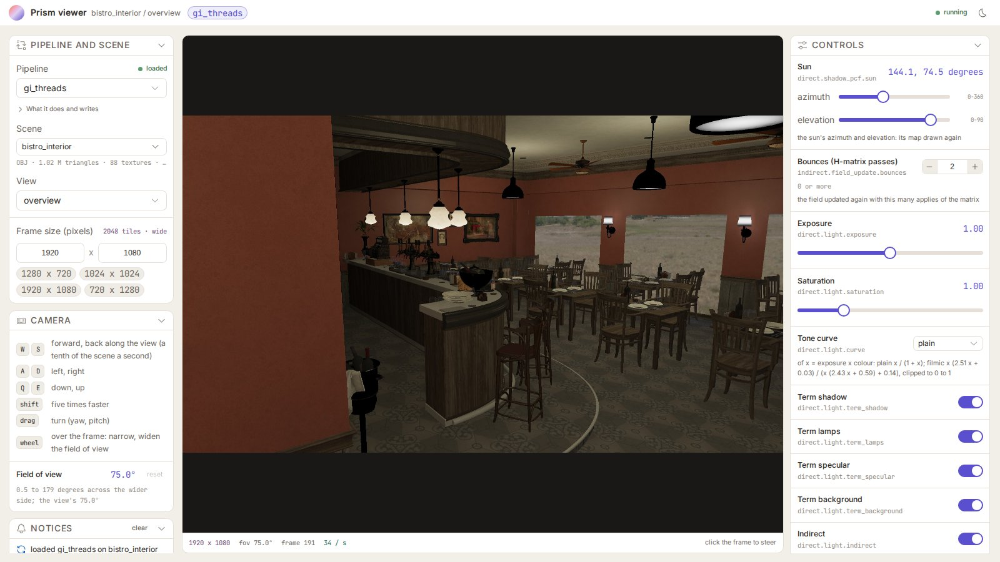

# Komorebi-Prism

[](LICENSE)

**A real-time renderer on Tenstorrent Blackhole cards, built on Komorebi: tile-resident
and matrix-heavy. glTF in, frame out.**

<picture>
  <source media="(prefers-color-scheme: dark)" srcset="docs/images/teaser-dark.svg">
  
</picture>

A frame is drawn by the card alone. The host writes the camera and sends one command,
FRAME, to a thread on the card's X280 cores, **the frame's thread**. It cuts the view's
work into threads and hands them out by **pulls**: every Tensix core asks for the next
one when it has finished its last, until none is left. The renderer is
**tile-resident**: the core that takes a tile's thread runs every step of that tile
(visibility, material, light, display) with the tile's planes kept in its own memory
between the steps, and writes only the tile's finished display page. It is
**matrix-heavy** where the light bounces: global illumination is a scene's
light-transport matrix, stored as a hierarchical matrix of dense and low-rank blocks and
applied with the cores' matrix engines; the field it makes is updated on the card when
the sun moves, by a thread of its own while the frames go on.

What is here: glTF scenes opened into the renderer's tables; visibility of the opaque,
masked and glass layers; textured materials; direct light from the sun with its shadow
map, the lamps and the sky; indirect light from a field the card updates itself; the
frame converted for display on the card. A command line, a loop that keeps a pipeline
loaded, and a viewer in the browser drive it. Every algorithm has a numpy reference, and
every frame is judged against the reference's picture. No release has been made; the
version is 0.0.0.

## Quick start

From a clone installed as in [Install](#install), on card 0: open a glTF file, draw it,
and steer the camera in the viewer.

```sh
export PRISM_DATA=$HOME/prism-data
python -m prism_cli open scene.glb --pipeline gi_threads --size 1920 1080 --card 0 --out out
python -m prism_cli run --pipeline gi_threads --scene NAME --view camera --size 1920 1080 \
    --frames 64 --path forward --card 0
python -m prism_viewer.server --host 127.0.0.1 --port 8790 --token TOKEN \
    --pipeline gi_threads --scene NAME --view camera --card 0
```

`open` converts the file once into the data root (a second `open` of the same file
converts nothing), makes its lights when it has none, draws 16 frames from the file's
camera and writes the last picture into `out/`; its one-line JSON record names the scene
(`NAME`, the file's stem and ten hex digits). `run` draws 64 frames with the eye moving
forward. A scene just opened has no far field: `gi_threads` draws it without the
indirect light (the record's `far_field` says so) until its indirect file and transport
set exist; `python scripts/data/public_scenes.py indirect NAME --transport sketch` makes
them once, on the host.
The viewer, once its page is built
(`cd apps/prism_viewer/web && npm install && npm run build`), is at
`http://127.0.0.1:8790/?token=TOKEN`. Every step, and the public scenes, are in [the quick start](docs/guides/quick_start.md).

## Install

**The machine.** Linux on x86-64, Python 3.13, and a Tenstorrent Blackhole P150A card
with Tenstorrent's kernel driver (`tenstorrent`) and the card's firmware. The runs in the
measurements were made with driver 2.12.0 and firmware bundle 19.13.1.0. The driver maps
a 1 GiB hugepage for each card into the process that opens it, the host channel; the
stage-wise presets push each frame's picture into it, and a session without it refuses
the push. Tenstorrent's `tt-smi` resets a card (`tt-smi -r 0`). Making the scenes' data
also needs a C++ compiler (`g++`), and the viewer's page needs Node.js and npm. One
process at a time can open a card; a second one is refused at once with the first one's
process id.

**The Python packages.** `pip install` brings all of these from PyPI. No tt-metal source
tree, `ttnn` or `torch` is needed.

| Package | What it brings |
|---|---|
| `komorebi-tt` 0.6.0 or later | Komorebi, the framework the card's programs are written in, and its command `kmr` |
| `komorebi-runtime`, through `komorebi-tt`'s extra `runtime` | Tenstorrent's tt-metal, built and pinned: its libraries, the cores' runtime, the X280 runtime, the locator for the RISC-V compiler |
| `numpy` | every array on the host |
| `pillow` (the extras `viewer` and `scenes`) | the viewer's JPEG frames; decoding the scenes' textures |

Leave `TT_METAL_HOME` unset: when it is set, Komorebi uses that tt-metal tree instead of
the runtime package. Install from a clone, because the presets, the kernels' sources and
the viewer's page are read from it:

```sh
git clone https://github.com/KohakuBlueleaf/Komorebi-Prism && cd Komorebi-Prism
python3.13 -m venv .venv && source .venv/bin/activate
pip install -e ".[viewer,scenes]"    # komorebi-tt and its runtime come from PyPI
kmr setup --card 0                   # once per card
```

`kmr setup --card 0` fetches the RISC-V compiler the runtime names and prepares card 0's
X280 memory, then asks for one reset (`tt-smi -r 0`); the preparation survives later
resets. `kmr doctor` checks the setup without opening the card. Komorebi keeps the
compiler, the runtime and its builds in `~/.cache/komorebi` (`KMR_CACHE` names another
folder); the first run of a preset compiles the card's program, so it starts slower than
later runs. The variables are in [the environment](docs/guides/environment.md).

## The renderer

<picture>
  <source media="(prefers-color-scheme: dark)" srcset="docs/images/frame-dark.svg">
  
</picture>

| step | what it computes | where it runs |
|---|---|---|
| count, place | each layer's triangles counted into the tiles their boxes reach, then written into the tiles' lists; a range of four triangle blocks a thread | the Tensix core that takes the range |
| sums | each slice of 16 tiles: its records (a tile thread each) in order of weight, every core's positions | every Tensix core, one command |
| running sum, the tile pull's choice | each layer's list place a slice; the next tile thread for the core that asks | the frame's thread, X280 cluster 1 |
| `visibility` | each layer's planes: 1/z, colour, triangle number, from the tile's lists | the core that takes the tile thread |
| `material`, `material_lit` | the material's colour or texel, the masked layer cut and merged, the glass layer blended; with lights, each layer's surface | the same core |
| `light` | the sun through its shadow map's filter, the lamps, the specular terms, the sky, the indirect field, emissive, the background, the tone step | the same core |
| `post` | the colour as 8-bit pixels, written to the tile's display page | the same core |
| the sun's shadow map | DEPTH views of the sun after it moves: `visibility`, `material_lit`, `depth_out` | the frame's thread hands them out; the Tensix cores draw them |
| the indirect field | the sources, a transport apply a bounce, the field's pages; swapped in between two frames | the job thread, X280 clusters 2 and 3; the applies on the lowest ranks |

The parts, the slots between them and the presets are in
[the renderer](docs/concepts/renderer.md); who hands out what and what a core keeps in
[the frame as threads](docs/concepts/threads.md); the indirect light in
[light transport](docs/concepts/light_transport.md).

The presets in [configs/pipeline](configs/pipeline): `gi_threads` is the renderer;
`lit_threads` is it without the indirect light, `textured_threads` without any light; `textured`, `lit` and `gi` run the same parts
stage-wise, as commands on every core one after another, and draw the pictures the
threads' presets are judged by; `raster`, `lit_tile`, `gi_tile`, `field` and `apply` are
parts and comparisons.

## The light

<picture>
  <source media="(prefers-color-scheme: dark)" srcset="docs/images/transport-dark.svg">
  
</picture>

*The light transport. Sponza's matrix is drawn from its transport set on 128 x 128
cells, each cell the kind holding most of its tiles; the ranges are the deal of its
receivers over 120 cores. The apply's time: one P150A, 120 cores, AICLK 1,350 MHz,
32 calls ([measurements/apply](measurements/apply/README.md)).*

<picture>
  <source media="(prefers-color-scheme: dark)" srcset="docs/images/field-dark.svg">
  
</picture>

*The field and its update. Sponza's field: 72,367 voxels of side 50.3, 1.08 million
weights ([the indirect reference](docs/internals/reference/indirect.md)). The update's
numbers: one P150A, 1,920 x 1,080, the sun set to (120, 40) once
([gi_threads](docs/performance/gi_threads.md)); the time axis is schematic.*

How the light is computed, part by part, is in
[light transport](docs/concepts/light_transport.md).

## Results

 
 

*Frames of `gi_threads` from [the viewer](docs/guides/viewer.md), 1,920 x 1,080 on one
P150A, at each view's own pose and the default sun: Sponza, the Bistro interior, the
Breakfast Room, and the viewer's page on the Bistro interior. Crytek Sponza, (c) 2010
Frank Meinl, Crytek, CC BY 3.0; Amazon Lumberyard Bistro, (c) 2017 Amazon Lumberyard,
CC BY 4.0 (Open Research Content Archive); Breakfast Room by Wig42 (Blend Swap),
CC BY 3.0; all three from Morgan McGuire's Computer Graphics Archive.*

<picture>
  <source media="(prefers-color-scheme: dark)" srcset="docs/images/results-dark.svg">
  
</picture>

*The frame and the load. The frame: the table below. The load: `prism_cli open` with
`lit`, the host part and the card part added, cold (the file converted, the caches empty,
the program built) and warm
([measurements/open](measurements/open/README.md), the waste cut).*

**The renderer's frame.** `gi_threads` against its stage-wise form `gi`: one Blackhole
P150A, 120 cores, AICLK 1,350 MHz, Komorebi 0.6.0, 2026-11-27, 1,920 x 1,080, 64 frames at
the view's camera, the median over frames 2 to 64, then over three runs, in ms; every
`gi_threads` picture equal to `gi`'s byte for byte. `gi` pushes its picture into the
host's memory inside its frame (0.565 ms) and `gi_threads` does not, so the like frame is
`gi` less its push; the ratio is `gi_threads` over it
([gi_threads](docs/performance/gi_threads.md)).

| scene (view) | `gi` less push | `gi_threads` | ratio |
|---|---:|---:|---:|
| sponza (overview) | 22.447 | 18.610 | 0.83 |
| bistro_interior (overview) | 33.282 | 24.182 | 0.73 |
| breakfast_room (overview) | 18.422 | 15.303 | 0.83 |
| salle_de_bain (overview) | 21.842 | 19.189 | 0.88 |
| modern_hall (overview) | 23.966 | 18.639 | 0.78 |
| modern_living_room (overview) | 25.647 | 18.196 | 0.71 |
| classroom_a1c62e93f7 (camera) | 21.394 | 19.170 | 0.90 |
| lynxsdesign_411c9daef8 (camera) | 53.802 | 49.474 | 0.92 |
| italian_flat_97f97a20ba (camera) | 48.023 | 42.224 | 0.88 |
| lynxsdesign_a01894bbb8 (camera) | 94.159 | 102.094 | 1.08 |

The threads' form is behind only on the largest scene, lynxsdesign_a01894bbb8: its count
and place pulls take 67.4 ms, against 69.9 ms for all the stage-wise raster's passes
with fill included, and the tile pull adds 34.4 ms on top. After a sun move `gi` stops
for 161.6 to 471.6 ms; `gi_threads` draws 2 to 7 frames during its update, each 1.25 to
1.36 times the steady frame.

**The threads' frame against the stage-wise frame, by preset.** One Blackhole P150A, 120 cores,
AICLK 1,350 MHz, 2026-11-27, 1,920 x 1,080, 16 frames at the scene's camera: the median
over frames 2 to 16, then over three runs, in ms. Every frame's picture equal to the
stage-wise frame's (0 pixels different). The threads' frame with the tile pull's
default choice `prefer`; the rows marked (a) were built with the account, which costs
about 1 % ([measurements/threads_account](measurements/threads_account/README.md)).

| scene | list entries a frame | `textured` stage-wise | `textured_threads` | `lit` stage-wise | `lit_threads` |
|---|---:|---:|---:|---:|---:|
| Sponza, overview | 293,571 | 16.428 | 13.134 | 18.838 | 14.584 (a) |
| classroom | 668,006 | 23.216 | 23.469 (a) | | |
| lynxsdesign | 2,072,780 | 42.843 | 45.050 (a) | 48.640 | 44.571 (a) |
| hidden alley | 2,564,913 | 53.544 | 61.899 (a) | 57.700 | 49.396 (a) |

On the artists' scenes the threads' `textured` frame is slower: one heavy tile thread ends
the tile pull (34.5 ms on hidden alley), because the threads' presets cut no tile into
bands (`heavy` 0). Cut at a weight taken from the frame's data, hidden alley `textured` is
53.663 ms and classroom 18.687 ms. Where the frame's time goes, pull by pull and core by
core, is in [the account](docs/performance/account.md).

**The stage-wise presets by scene and size.** One P150A at AICLK 1,350 MHz, its link at
16 GT/s, 2026-11-26, the scenes' overviews; the card frame (the median of a run's
frames, from FRAME to the picture pushed into the host's memory), in ms:

| preset | scene | 1,024 x 1,024 | 1,280 x 720 | 1,920 x 1,080 |
|---|---|---:|---:|---:|
| `raster` | sponza | 4.962 | 4.673 | 7.813 |
| `raster` | bistro_interior | 7.984 | 8.234 | 11.570 |
| `raster` | bistro_exterior | 13.340 | 12.513 | 16.740 |
| `textured` | sponza | 10.781 | | |
| `textured` | bistro_interior | 15.442 | | |
| `textured` | bistro_exterior | 27.688 | | |
| `lit` | sponza | 12.050 | 10.882 | 18.952 |
| `lit` | bistro_interior | 18.136 | 18.342 | 28.914 |
| `lit` | bistro_exterior | 27.947 | 26.116 | 38.958 |
| `gi` | sponza | 14.267 | 12.800 | 23.177 |
| `gi` | bistro_interior | 20.987 | 20.721 | 33.894 |
| `gi` | modern_hall | 13.734 | 12.043 | 24.567 |

Outside the frame, on Sponza at 1,024 x 1,024: the sun's first pass of a run 19.18 ms, the
field's update of `gi` 124.87 ms at 2 bounces, the transport's apply alone 2,609.3 us.
Every number with its check is in [frames](docs/performance/frames.md); the update beside
the frames in [measurements/update_beside](measurements/update_beside/README.md); a glTF
file's load, cold and warm, in [load](docs/performance/load.md); the card's picture
against Cycles reading the same glTF file in [glTF truth](docs/performance/gltf_truth.md).

## The scenes

<picture>
  <source media="(prefers-color-scheme: dark)" srcset="docs/images/scene-dark.svg">
  
</picture>

*A glTF file opened. The seconds and megabytes: one P150A, 8 or 24 CPUs of the host,
2026-11-26 and 27 ([measurements/open](measurements/open/README.md),
[measurements/transport_build](measurements/transport_build/README.md)).*

| kind | which | how they come |
|---|---|---|
| public scenes | `sponza`, `bistro_interior`, `bistro_exterior`, `conference`, `breakfast_room`, `salle_de_bain`, `modern_hall`, `modern_living_room` | downloaded from their sources and converted by `scripts/data/public_scenes.py`, each under its own licence ([scenes](docs/concepts/scenes.md)) |
| glTF files | any `.glb` or `.gltf`; measured on artists' scenes of 0.6 to 9 million triangles (classroom, italian_flat, lynxsdesign, hidden_alley) | `python -m prism_cli open FILE` ([glTF scenes](docs/guides/gltf_scenes.md)); Blender scenes exported by the workbench ([artists' scenes](docs/guides/artist_scenes.md)) |
| generated scenes | `tiny`, `s10k`, `s100k`, `s1m` | `scripts/data/generated_scenes.py`; vertex colours only (`raster`) |

## Limits

- **One card.** A run uses one P150A (`--card`).
- **What a scene's materials and lights keep**: no refraction, no glass behind glass (one
  transparent layer, the nearest), no coloured shadows, no mirrors or metals'
  reflections; masked, blended and transmitting surfaces cast opaque shadows; sheen and
  clearcoat are dropped; Blender's view transforms (Filmic, AgX) are not applied: the
  display is a power transfer (2.2) or the standard sRGB one
  ([scenes](docs/concepts/scenes.md#limits), [glTF truth](docs/performance/gltf_truth.md)).
- **32 lamps a scene.** LIGHT's table holds 32 lamps (`kLampsMax`); a scene with more is
  refused when its lamps are lit.
- **No tile is cut in the threads' presets** (`heavy` 0): a tile with far more entries
  than the others is one tile thread and can end the tile pull. A weight that follows the
  frame's data on the card is not in the threads' form.
- **A scene opened from glTF has no far field** until its transport is built: the
  indirect file and the transport set are made on the host once per scene by
  `public_scenes.py indirect` (Sponza: 78 s block by block, 561 s dense;
  [the transport's build](docs/performance/transport_build.md)), and until then `gi`,
  `gi_threads` and `gi_tile` draw it without the indirect light.
- **A plain glTF export loses part of an artist's scene** (materials, sky, framing or
  geometry, by scene): what it keeps and what it loses is in
  [glTF truth](docs/performance/gltf_truth.md).
- **The presets that read a scene's materials** (`textured`, `lit`, `gi` and their
  threads' forms) are refused on a generated scene.
- **A size past the capacity a load holds** is a reload of the program; a load that is
  refused stays at the size before. Lists too small for a camera grow in the live run.
- **The viewer's field of view** is 0.5 to 179 degrees.
- **Komorebi 0.6.0 or later.**

## Repository map

```text
src/prism_common/          registry and build, slots and their contract, formats, paths
src/prism_reference/       the algorithms in numpy: scene (generated, public, opened glTF),
                           raster, material, direct, indirect (field, hierarchical matrix),
                           post, trace (the box tree, the batch tracer), native, io
src/prism/
  core/                    the pipeline, an implementation and its host's contract, the
                           unit, a step and a kind (thread/), the thread's layout, shared
                           fields, capacity, controls; include/ (device headers shared)
  stages/                  raster; material/texture; direct/shadow_pcf, direct/light;
                           indirect/transport, indirect/field_update; post/show; each
                           with its steps/ (its step of the tile thread)
  program/                 the assembly: form (stage-wise or threads), threads/ (the threads'
                           presets' assembly, tile threads, hosts), dispatch/ (the view's
                           pulls on the frame's thread), frame/ (the handler work), jobs/
                           (the job thread), director/ (the thread's runtime in C)
  loop/                    a pipeline kept loaded: frames, sizes, recoveries, camera paths
  check/                   the harness: a preset's frames against prism_reference
apps/
  prism_cli/               the command line: run, open
  prism_viewer/            the viewer: server/ and web/ (Vue 3 + Vite)
configs/pipeline/          the presets
scripts/                   run/ (presets, stages, accounts), data/ (the scenes), blender/
checks/                    behaviour scripts run by hand; repo_rules.py
docs/                      concepts, guides, internals, performance; images/
measurements/              every recorded run, a README a folder
```

## Documentation

| Page | Read it for |
|---|---|
| [docs index](docs/README.md) | every page by kind |
| [quick start](docs/guides/quick_start.md) | from an installed Komorebi to a picture and the viewer |
| [the renderer](docs/concepts/renderer.md) | the pipeline, the slots between its parts, the presets |
| [the frame as threads](docs/concepts/threads.md) | the kinds, the tile thread and its steps, the pulls, what a core keeps, the views |
| [light transport](docs/concepts/light_transport.md) | elements, the transport matrix as blocks, its apply, the field and its update |
| [scenes](docs/concepts/scenes.md) | the public and generated scenes, their credits, materials, lighting and indirect light |
| [the command line](docs/guides/cli.md), [the viewer](docs/guides/viewer.md) | `run`, `open`, the preset runner; the server and the page |
| [glTF scenes](docs/guides/gltf_scenes.md), [artists' scenes](docs/guides/artist_scenes.md) | opening a glTF file; Blender scenes and the truth by Cycles |
| [dispatch](docs/internals/program/dispatch.md), [work](docs/internals/program/work.md), [steps](docs/internals/program/steps.md) | how the frame's thread and the handler `work` run a view |
| [gi_threads](docs/performance/gi_threads.md), [frames](docs/performance/frames.md), [account](docs/performance/account.md), [transport build](docs/performance/transport_build.md) | the renderer's frame and its update on ten scenes; the frame's time by preset, scene and size; where a threads' frame's time goes; the transport set's two builds on the host |
| [checks](docs/guides/checks.md), [scripts](scripts/README.md), [measurements](measurements/README.md) | what each check covers; every script; the records |

## Licence and credits

The code is under the Apache License 2.0 ([LICENSE](LICENSE)).

The repository holds no scene: the scenes are public ones, downloaded from their sources
by `scripts/data/public_scenes.py`, each under its own licence. The pictures in the docs
show Crytek Sponza (Frank Meinl, Crytek; CC BY 3.0) and the Amazon Lumberyard Bistro
(Amazon Lumberyard, ORCA; CC BY 4.0), both from Morgan McGuire's Computer Graphics Archive.
Every scene's source, credit and licence is in
[docs/concepts/scenes.md](docs/concepts/scenes.md#scenes-and-attribution).
