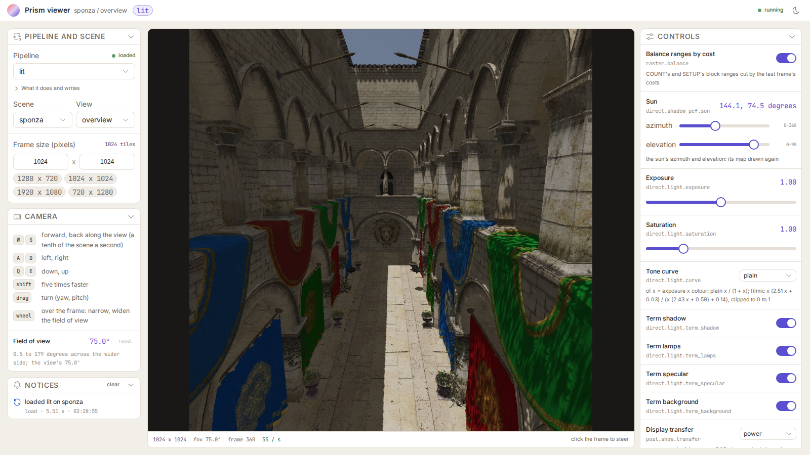

# Komorebi-Prism

[](LICENSE)

**A real-time rendering pipeline on Tenstorrent Blackhole cards, built on Komorebi.**

<picture>
  <source media="(prefers-color-scheme: dark)" srcset="docs/images/teaser-dark.svg">
  
</picture>

A frame is one command. The host writes the camera and sends a FRAME command to a thread
on one of the card's X280 cores, the director; the director runs each stage on the 120
Tensix cores, one command after another with no host between them, and the card pushes
the finished picture into the host's memory. Which stages run is a preset: a list naming
one implementation for each item of the pipeline, assembled into one program on every
core and one thread. What is here: visibility of the scene's opaque, masked and glass
layers; textured materials; direct light from the sun with its shadow map, the lamps and
the sky; indirect light from a field the card updates itself when the sun moves; the
frame converted for display on the card. A command line, a loop that keeps a pipeline
loaded, and a viewer in the browser drive it.

Every stage is checked against a numpy reference of the same algorithm, and the whole
frame against the reference's picture. On one P150A at 1,024 x 1,024, the card frame the
median of a run's frames:

| Preset, Sponza overview | Card frame | Check: the frame's picture against the reference |
|---|---:|---|
| `raster`: visibility, vertex colours | 4.962 ms (169.9 frames a second by the host's clock) | 0 pixels differ (frames 1, 100, 200) |
| `textured`: and the materials' textures | 10.781 ms | 8 pixels differ, the largest error 16 of 255 |
| `lit`: and direct light | 12.050 ms | a share of 0.000459 over 2 of 255 apart, the largest error 75 |
| `gi`: and the indirect field | 14.267 ms | a share of 0.000772 over 2 apart, the largest error 105 |

Every scene and size is under [Results](#results). No release has been made; the version
is 0.0.0.

## Running it

**The machine.** Linux on x86-64, Python 3.13, and a Tenstorrent Blackhole P150A card
with Tenstorrent's kernel driver (`tenstorrent`) and the card's firmware. The runs in
this README were made with driver 2.12.0 and firmware bundle 19.13.1.0. The driver maps a
1 GiB hugepage for each card into the process that opens it, the host channel. The card
pushes each frame's picture into it, so the pipeline needs it: a session without the
channel refuses the push. The machine of these runs reserves eight 1 GiB hugepages
(`/sys/kernel/mm/hugepages/hugepages-1048576kB/nr_hugepages`).
Tenstorrent's `tt-smi` resets a card (`tt-smi -r 0`). Making the scenes' data also needs
a C++ compiler (`g++`), and the viewer's page needs Node.js and npm. One process at a
time can open a card; a second one is refused at once with the first one's process id.

**The Python packages.** `pip install` brings all of these from PyPI. No tt-metal source
tree, `ttnn` or `torch` is needed.

| Package | What it brings |
|---|---|
| `komorebi-tt` 0.5.3 or later | Komorebi, the framework the card's programs are written in, and its command `kmr`. 0.5.3 is the first release whose merged program leaves `gi` the stack it needs on every scene |
| `komorebi-runtime` 0.81.1.4, through `komorebi-tt`'s extra `runtime` | Tenstorrent's tt-metal v0.81.1, built and pinned: its libraries, the cores' runtime, the X280 runtime, and the locator for the RISC-V compiler |
| `numpy` | every array on the host |
| `pillow` (the extras `viewer` and `scenes`) | the viewer's JPEG frames; decoding the public scenes' textures |

Leave `TT_METAL_HOME` unset. When it is set, Komorebi uses that tt-metal tree instead
of the runtime package. Install from a clone, because the presets, the kernels' sources
and the page are read from it:

```sh
git clone https://github.com/KohakuBlueleaf/Komorebi-Prism && cd Komorebi-Prism
python3.13 -m venv .venv && source .venv/bin/activate
pip install -e ".[viewer,scenes]"    # komorebi-tt and its runtime come from PyPI
kmr setup --card 0                   # once per card
```

`kmr setup --card 0` does two things once:
- it fetches the RISC-V compiler the runtime names into the cache folder;
- it prepares card 0's X280 memory (it primes the ECC of the X280 tiles' local memory),
  then asks for one reset, `tt-smi -r 0`.

The preparation survives later resets, so it is needed once per card. On a card that
was already prepared, it changes nothing and says so. Nothing else may use the card while
it runs.

`kmr doctor` then checks the setup without opening the card. It prints:
- the runtime, `from komorebi-runtime 0.81.1.4`;
- the X280 compiler's path, which reads `not found` until the setup has run;
- one line per card from the driver's files: its type (`p150a`), its firmware, its
  clock, whether its heartbeat is advancing, its device node (`/dev/tenstorrent/0`) and
  the process holding it.

A card that cannot be opened gets a `NOT READY` line naming the reset to run.

Komorebi keeps the compiler, the runtime and its builds in `~/.cache/komorebi`
(`KMR_CACHE` names another folder; a new folder needs `kmr setup` again). The first run
of a preset compiles the card's program and keeps it there, so it starts slower than
later runs.

The scenes are downloaded from their public sources and converted under the data root,
`$PRISM_DATA`, a folder outside the clone
([scenes and their licences](docs/concepts/scenes.md)). For Sponza:

```sh
export PRISM_DATA=$HOME/prism-data
python scripts/data/public_scenes.py fetch sponza       # the mesh: 80 MB downloaded
python scripts/data/public_scenes.py materials sponza   # its textures (raster needs none)
python scripts/data/public_scenes.py lighting sponza    # the sky map, 23 MB; sun and sky (lit)
python scripts/data/public_scenes.py indirect sponza    # the indirect light (gi): 10 to 30 minutes
```

`indirect` writes 1.8 GB and keeps 6 GB of work files in
`$PRISM_DATA/public/sponza_indirect_work/`; these may be deleted afterwards. This runs
a preset on the card (`raster`, `lit` or `gi`) and checks its frame 0 against the
reference ([the command line](docs/guides/cli.md)):

```sh
python -m prism_cli run --pipeline lit --scene sponza --view overview --size 1024 1024 \
    --check 0 --card 0
```

The viewer ([its guide](docs/guides/viewer.md)): build the page once, start the server,
then open `http://127.0.0.1:8790/?token=TOKEN`:

```sh
(cd apps/prism_viewer/web && npm install && npm run build)
python -m prism_viewer.server --host 127.0.0.1 --port 8790 --token TOKEN \
    --pipeline lit --scene sponza --view overview --card 0
```

## Quick start

From a clone installed as above, on card 0, the preset `lit` on Sponza (`raster` needs
only the mesh, the first download):

```sh
export PRISM_DATA=$HOME/prism-data
python scripts/data/public_scenes.py fetch sponza
python scripts/data/public_scenes.py materials sponza
python scripts/data/public_scenes.py lighting sponza
python -m prism_cli run --pipeline lit --scene sponza --view overview --size 1024 1024 \
    --check 0 --card 0
```

The last command opens the preset on the card, renders its frames from the view's own
camera, compares frame 0's picture with the reference's and prints one JSON line: the
card's times by stage and by layer, the host's frame, and the picture's numbers. To steer
the camera and see the frames, start [the viewer](#the-viewer).

## The pipeline

<picture>
  <source media="(prefers-color-scheme: dark)" srcset="docs/images/frame-dark.svg">
  
</picture>

A pipeline is a list of implementations in order; each fills an item (`raster`,
`material`, `direct`, `indirect`, `post`) or none, and names the slots it reads and
writes. A **slot** is a named value passed between implementations, with its format and
what it holds (`src/prism_common/slots.py`): `frame.visibility` is per tile the five
planes depth (1/z), red, green, blue and the triangle number; `frame.lists` each layer's
directory and lists; `mesh.attributes` each layer's shade blocks; `frame.surface` each
layer's lit surface; `light.shadow_map` the sun's shadow map in light pages of 32 x 32;
`view.depth` the DEPTH views' cameras; `display.picture` the frame for display, a page a
tile of 32 x 32 pixels. A pipeline whose reads are not given or written earlier is
refused when it is made, naming the slot.

On the card, every implementation with a class has its handlers on every Tensix core (one
program), and every implementation has a **unit**: C that the frame's thread, the
**director**, runs on X280 cluster 1. The director knows no stage: its sequence is
generated from the preset, and a frame runs each unit in turn, a layer unit once a layer.
The stages:

- **raster** (`src/prism/stages/raster`): visibility. Per layer, the passes COUNT, SUM,
  HIST, HSUM, PLACE, SETUP and FILL on every core, and between COUNT and SETUP a middle
  pass on the director, spread over the cluster's four cores, that cuts heavy tiles into
  bands and deals the items to the cores by cost
  ([the raster model](docs/internals/raster/model.md)). It reads `scene.mesh` and
  `view.camera` and writes `frame.visibility` and `frame.lists`. A frame is exact: every
  pixel sees the same triangles in the same order as the reference.
- **material.texture**: SHADE on every core. Each pixel FILL left gets its material's
  colour, a textured material its albedo texel, read from the scene's texture pages; the
  masked layer is merged into the opaque one and the glass layer blended over it. With
  lights it writes each layer's surface (material word, normal, specular, albedo) for
  LIGHT. Reads `frame.visibility` and `frame.lists`, writes `mesh.attributes` and
  `frame.surface`.
- **direct.shadow_pcf**: the sun's shadow map, drawn by the frame's own units. It has no
  class and no frame work; it serves the thread command `sun` ([below](#the-sun-the-shadow-and-the-indirect-light)).
  Writes `light.shadow_map` and `view.depth`.
- **direct.light**: LIGHT on every core, once a view: the sun with its shadow map's
  filter (the PCF), the lamps, the specular terms, the sky, the ambient or the indirect
  field, emissive and the background, then the tone step. A scene with glass runs it
  twice: the linear colour, then the glass layer lit over it. Reads `frame.visibility`,
  `mesh.attributes`, `frame.surface` and `light.shadow_map`; writes `frame.visibility`.
- **indirect.transport**: one apply `y = M x` of the scene's light-transport matrix,
  stored as a hierarchical (block low-rank) matrix, on every core as one command. Reads
  `elements.radiance`, writes `elements.irradiance`.
- **indirect.field_update**: the indirect field made again on the director after the
  sun moves, its parts on the cluster's four cores, each bounce pass an apply of
  `indirect.transport`. It has no class: a unit and a host. Writes `light.field`.
- **post.show**: SHOW turns the frame's colour planes into 8-bit pixels, a page of the
  display a tile, on every core; then the director's PUSH puts the frame's pages into the
  host's memory, where the host lays them into the picture. The display's transfer (a
  power, by default 2.2, or the piecewise sRGB) is a control. Reads `frame.visibility`,
  writes `display.picture`.

**Layers and views.** With a scene's materials the raster host splits the triangles into
up to three layers by material kind: opaque, masked (cut out where its mask's alpha is under 128) and
glass; each layer has its own lists and directory, and a layer unit runs once for each.
Without materials there is one layer. A **view** is what a run of the units draws: view
0 is the eye's, of kind COLOUR, where every unit does its work; a DEPTH view's product is
the nearest surface's 1/z, written into its target. The sun's shadow map is drawn as
DEPTH views, one a quadrant of the map: the opaque and masked layers' raster, SHADE's
merge of the masked layer's 1/z, and SHOW's COPY of 1/z into the map; LIGHT does nothing
in it.

A loop (`prism.loop`) keeps a pipeline loaded: a frame from a camera, a change of size (a
reload only past the capacity it holds), a host's recovery from a frame's code (a retry
or a reload), and every frame's times row kept across reloads. Controls (the sun, the
exposure, the tone curve, each light term, the bounces, the display's gamma) are set live
from the host between frames.

## Presets

A preset is a file of [configs/pipeline](configs/pipeline): `PIPELINE`, its `OPTIONS`,
and for the picture presets the reference a frame is compared with and the judge of its
numbers ([the command line](docs/guides/cli.md)).

| Preset | What it runs | What it needs of the scene's data |
|---|---|---|
| `raster` | `raster`, `post.show`: visibility with the vertex colours, the picture pushed | the mesh (`fetch`), or a generated scene |
| `textured` | `raster`, `material.texture`, `post.show` | a public scene's view and its materials (`materials`) |
| `lit` | `raster`, `material.texture`, `direct.shadow_pcf`, `direct.light`, `post.show` | a view, its materials and its lighting (`lighting`) |
| `gi` | `lit`'s, with `indirect.transport` and `indirect.field_update`: the lit frame with the indirect field, updated on the card when the sun moves | a view, materials, lighting and the indirect light (`indirect`) |
| `field` | `indirect.transport`, `indirect.field_update`: the field's update alone, 2 bounces | lighting and the indirect light |
| `apply` | `indirect.transport` alone: the transport's apply, 32 calls | the indirect light's matrix files |

The picture presets run with `python -m prism_cli run --pipeline <preset> ...`, or
`python scripts/run/preset.py --pipeline <preset> ...` with the stage's check; the other
two with `python scripts/run/field.py --scene sponza --bounces 2` and
`python scripts/run/apply.py --scene sponza --calls 32` ([scripts](scripts/README.md)). The
scene names, their views and their licences are in [scenes](docs/concepts/scenes.md);
`tiny`, `s10k`, `s100k` and `s1m` are generated.

## How a pipeline is put together

<picture>
  <source media="(prefers-color-scheme: dark)" srcset="docs/images/assembly-dark.svg">
  
</picture>

The card's code is written in Komorebi's programming model
([its description](https://github.com/KohakuBlueleaf/Komorebi#the-programming-model)).
This is all of it the rest of this README uses:
- A **kernel** is code that a Tensix core runs. A core has five CPUs: two that move
  data (the movers) and three that compute (unpack, math, pack).
- A **handler** is one entry of a program, given a number.
- A **command** is one 64-byte line: the handler, a group of cores (a contiguous range)
  and ten 32-bit argument words. Every core of the group runs that handler with those
  words, and the group reports back with an event.
- A **class** is a program written in Python: its handlers as methods, with their
  buffers and constants. It is compiled to C++ kernels, and a handler may also be C++
  written by hand (`km.kernel`).
- A **thread** is C code on one of the card's X280 cores. It sends commands to the
  Tensix cores itself and waits for their events. A thread is also sent thread commands
  of its own, such as FRAME.

An implementation is a folder of `src/prism/stages/<stage>/<implementation>/`, and what it
shows the pipeline is its declaration: the items it fills, the slots it reads and
writes, its class, its host and its unit. `material.texture`'s, whole:

```python
TEXTURE = IMPLEMENTATIONS.register(
    "material.texture",
    Implementation(
        name="material.texture",
        fills=("material",),
        reads=("frame.visibility", "frame.lists"),
        writes=("mesh.attributes", "frame.surface"),
        device=made,
        host=TextureHost,
        check=check,
        thread=UNIT,
    ),
)
```

Beside it: `device.py` (`Shade`, a Komorebi class with one `km.kernel` handler whose C++
is under `kernels/`, split by what each CPU of a core does: `mover_a/`, `mover_b/`,
`pack/`), `thread/material_texture_unit.c` (its unit: a layer's SHADE from that layer's
columns), `unit.py` (the unit's role and what it asks the core for), `host.py`
(`TextureHost`: the tensors, the slots it gives, the slots it takes from the raster host),
`model/` (the card's data on the host, in numpy), `check/` (its frames against the
reference) and a README.

`prism.program.assemble` prepares each host, makes each class and merges them with
`km.merge` into one program; it generates the director's sequence from the units and
declares the thread with every unit's C. An implementation never writes a handler number,
a buffer index, a thread region or a word's place: it says what it needs, and
`prism.core` assigns it or refuses with the numbers. A slot crosses from one
implementation to another by its name only, on the thread (a unit gives or takes it)
and on the host (a host gives its tensor, another connects to it).

## The sun, the shadow and the indirect light

<picture>
  <source media="(prefers-color-scheme: dark)" srcset="docs/images/light-dark.svg">
  
</picture>

The sun is a control, `direct.shadow_pcf.sun` (azimuth and elevation). When it moves, the
shadow host rewrites its part of the sun region and asks for the thread command `sun`,
which the loop sends after the hosts' views and before the next FRAME: the director runs
one DEPTH view a quadrant of the map through the same units as a frame, and the map is
written in place, `light.shadow_map`. LIGHT's table, with the sun's words, is written
again by the light host. Below the horizon nothing is sent. On Sponza at 1,024 x 1,024 the
first pass of a run takes 19.18 ms
([lit_frame](measurements/lit_frame/README.md)).

In `gi` a pixel's ambient and its sky with the baked visibility are replaced by the
indirect field: a voxel grid of irradiance, six directions a voxel, looked up at the
pixel with trilinear weights. The field comes from a few tens of thousands of surface
elements (36,832 for Sponza) and the scene's light-transport matrix between them, both
made once by `public_scenes.py indirect` ([indirect light](docs/internals/reference/indirect.md)).
When the sun differs from the one the field was made for, the field's host asks for the
command `update` after `sun`: on the director, each element's first light from the new
sun, its shadow map, the lamps and the sky; then the bounce passes, each one apply of the
transport's matrix on every core (`bounces`, 2 by default, is a control); then the
field's values, its texels (a has-data bit and three square-root codes) and its pages,
stored where LIGHT reads them, `light.field`. A command `field_scale` returns the scale,
and the light host writes LIGHT's table from it. On Sponza at 2 bounces the update takes
124.87 ms on the card ([gi_frame](measurements/gi_frame/README.md#the-update-in-the-loop)).

## The viewer



A page in the browser that steers the camera (keys W, A, S, D, Q, E, a drag to turn, the
wheel for the field of view), chooses the preset (`raster`, `textured`, `lit`, `gi`), the
scene and its view and the frame's size, sets every control the loop lists, and shows
the frames the card renders with the card's times by stage and the host's. The server
(`apps/prism_viewer/server`) owns the card's session and the loop; the page
(`apps/prism_viewer/web`) is a Vue 3 + Vite project. The frames reach the page as JPEGs
encoded beside the render loop, which never waits for them. Starting it is in
[Running it](#running-it); everything it does is in [its guide](docs/guides/viewer.md).

## Results

 
 

*The viewer's pictures from [its guide](docs/guides/viewer.md): `lit` on Sponza at the
default sun; `textured` on the Bistro interior; `lit` with the sun moved; `lit` with the
shadow term off. Crytek Sponza, (c) 2010 Frank Meinl, Crytek, CC BY 3.0; Amazon
Lumberyard Bistro, (c) 2017 Amazon Lumberyard, CC BY 4.0 (Open Research Content
Archive); both from Morgan McGuire's Computer Graphics Archive.*

On one Blackhole P150A at AICLK 1,350 MHz, its link to the host at 16 GT/s, every run on
2026-11-26, on the scenes' overviews. The card frame is the median of a run's frames, in
ms, from the director's FRAME to the picture pushed into the host's memory:

| Preset | Scene | 1,024 x 1,024 | 1,280 x 720 | 1,920 x 1,080 |
|---|---|---:|---:|---:|
| `raster` | sponza | 4.962 | 4.673 | 7.813 |
| `raster` | bistro_interior | 7.984 | 8.234 | 11.570 |
| `raster` | bistro_exterior | 13.340 | 12.513 | 16.740 |
| `textured` | sponza | 10.781 | | |
| `textured` | bistro_interior | 15.442 | | |
| `textured` | bistro_exterior | 27.688 | | |
| `lit` | sponza | 12.050 | 10.882 | 18.952 |
| `lit` | bistro_interior | 18.136 | 18.342 | 28.914 |
| `lit` | bistro_exterior | 27.947 | 26.116 | 38.958 |
| `gi` | sponza | 14.267 | 12.800 | 23.177 |
| `gi` | bistro_interior | 20.987 | 20.721 | 33.894 |
| `gi` | modern_hall | 13.734 | 12.043 | 24.567 |

By the host's clock, the `raster` frame at 1,024 x 1,024 is 5.885 ms on sponza (169.9
frames a second), 8.866 ms on bistro_interior (112.8) and 14.265 ms on bistro_exterior
(70.1). The parts of a `gi` frame at 1,024 x 1,024, in ms: raster is its eight passes
over every layer, SHADE every layer, LIGHT with its glass form (the glass form's part
also shown on its own):

| Scene | Frame | raster | SHADE | LIGHT | LIGHT glass | SHOW | PUSH |
|---|---:|---:|---:|---:|---:|---:|---:|
| sponza | 14.267 | 5.040 | 4.156 | 3.992 | - | 0.793 | 0.286 |
| bistro_interior | 20.987 | 9.059 | 4.659 | 6.123 | 1.257 | 0.864 | 0.286 |
| modern_hall | 13.734 | 2.324 | 2.207 | 8.082 | 2.147 | 0.831 | 0.286 |

The commands outside the frame, at 1,024 x 1,024, in ms (the apply in µs):

| What | sponza | bistro_interior | bistro_exterior | modern_hall |
|---|---:|---:|---:|---:|
| `sun`, the first pass of a run, sun at (120, 40) | 19.18 | 32.85 | 56.80 | |
| `update` in `gi`, 2 bounces | 124.87 | 134.58 | | 176.96 |
| `update` in `gi`, 0 bounces | 100.39 | 112.06 | | 152.26 |
| the transport's apply, `apply` | 2,609.3 µs | 4,288.0 µs | | |

Every picture is checked against the reference at its setting. The records are in
[raster_show](measurements/raster_show/README.md),
[textured_show](measurements/textured_show/README.md),
[lit_frame](measurements/lit_frame/README.md),
[gi_frame](measurements/gi_frame/README.md) and
[apply](measurements/apply/README.md); [frames](docs/performance/frames.md) gathers every
preset's numbers, and [measurements](measurements/README.md) holds every record with its
card, date and command.

## Checking it

**The reference.** `prism_reference` holds every algorithm in numpy, by the same stage
names: the scenes, the raster with SHADE, direct light, the indirect light, the display's
conversion and a batch ray tracer, with no Komorebi and no card. It is the source of the
data the card's stages read and of the pictures they are judged by
([reference pages](docs/internals/reference/raster.md)).

**The stages' checks.** Every implementation has a check of its own on the card: the
preset's frames through `prism.check.harness`, each checked picture against the
reference with the preset's judge (pixels that differ, or the shares over 2, 4 and 8 of
255 and the largest error), the codes, and the times by stage and layer, written as a
record under `measurements/`:

```sh
python scripts/run/preset.py --pipeline lit --scene sponza --view overview --size 1024 1024
```

A run of the command line checks the frames it is given in the same way
(`python -m prism_cli run ... --check 0`, under [Running it](#running-it)). The viewer's
server has a check of its own (`python -m prism_viewer.server.check`), which
also compares the frames it serves with the loop's pictures.

**Without a card.** `python -m checks.raster_model` builds the raster's middle pass in C
with the host's compiler and runs it against the raster model
([checks](checks/README.md)). `python checks/repo_rules.py` (the import direction between
the packages, file length, ASCII, imports inside functions), `black`, `ruff`,
`clang-format` and the page's lint and build run on every push
([the workflow](.github/workflows/ci.yml)).

## Limits

- **One card.** A run uses one P150A (`--card`).
- **What the scenes do not represent**: refraction, glass behind glass (one transparent
  layer, the nearest), coloured shadows, mirrors and metals' reflections; a scene's own
  lights outside its lighting entry ([scenes](docs/concepts/scenes.md#limits)).
- **The scenes are downloaded**, each under its own licence, and the indirect light is
  made on the host once (10 to 30 minutes for Sponza, 1.8 GB written and 6 GB of work
  files).
- **The presets that read a scene's materials need a public scene's view**: `textured`,
  `lit` and `gi` are refused on a generated scene.
- **A size past the capacity a load holds** is a reload of the program; a load that is
  refused stays at the size before ([the viewer](docs/guides/viewer.md)).
- **The viewer's field of view** is 0.5 to 179 degrees.
- **Komorebi 0.5.3 or later.**

## Repository map

```text
src/prism_common/          registry and build, slots and their contract, formats, paths
src/prism_reference/       the algorithms in numpy: scene (generated and public), raster,
                           material, direct, indirect (field, hierarchical matrix), post,
                           trace (the box tree, the batch tracer), native (compiled helpers), io
src/prism/
  core/                    the pipeline, an implementation and its host's contract, the
                           unit, the thread's layout, shared fields, capacity, controls;
                           include/ (device headers the stages share)
  stages/                  raster; material/texture; direct/shadow_pcf, direct/light;
                           indirect/transport, indirect/field_update; post/show
  program/                 the assembly into one program; director/ (the thread's runtime
                           in C and the generated sequence)
  loop/                    a pipeline kept loaded: frames, sizes, recoveries, camera paths
  check/                   the harness: a preset's frames against prism_reference; field_frames
apps/
  prism_cli/               the command line
  prism_viewer/            the viewer: server/ and web/ (Vue 3 + Vite)
configs/pipeline/          the presets
scripts/                   run/ (presets and stages), data/ (the scenes)
checks/                    raster_model/ (the raster's middle pass in C against its model);
                           repo_rules.py (the repository's rules)
docs/                      concepts, guides, internals, performance; images/ (the figures
                           and the script that draws them)
measurements/              every recorded run
```

## Documentation

| Page | Read it for |
|---|---|
| [docs index](docs/README.md) | the pages by kind |
| [scenes](docs/concepts/scenes.md) | the generated and public scenes, their credits, conversion, materials, lighting and indirect light |
| [the command line](docs/guides/cli.md) | the presets, `prism_cli run`, the preset runner and the record they write |
| [environment](docs/guides/environment.md) | the variables the code reads |
| [the viewer](docs/guides/viewer.md) | the server, the page, the path of a frame, the controls, the keys |
| [raster model](docs/internals/raster/model.md) | the raster stage's data on the host: records, lists, costs, heavy tiles, the middle pass, capacity |
| [texture model](docs/internals/material/texture_model.md) | the texture stage's data: shade blocks, texture pages, SHADE's table, layers |
| [light model](docs/internals/direct/light_model.md) | the direct-light stage's data: surface planes, terms, light pages, LIGHT's table, the sun, the field as LIGHT reads it |
| [post.show](docs/internals/post/show.md) | the display's conversion, on the card, its unit and its host |
| reference: [raster](docs/internals/reference/raster.md), [material](docs/internals/reference/material.md), [direct](docs/internals/reference/direct.md), [indirect](docs/internals/reference/indirect.md), [trace](docs/internals/reference/trace.md) | the algorithms in `prism_reference` |
| [frames](docs/performance/frames.md) | every preset's card frame and its parts, by scene and size |
| [checks](checks/README.md), [scripts](scripts/README.md), [measurements](measurements/README.md) | what each check covers; every script and its options; the records |
| [CLAUDE.md](CLAUDE.md) | the repository's conventions |

## Licence and credits

The code is under the Apache License 2.0 ([LICENSE](LICENSE)).

The repository holds no scene: the scenes are public ones, downloaded from their sources
by `scripts/data/public_scenes.py`, each under its own licence. The pictures in the docs
show Crytek Sponza (Frank Meinl, Crytek; CC BY 3.0) and the Amazon Lumberyard Bistro
(Amazon Lumberyard, ORCA; CC BY 4.0), both from Morgan McGuire's Computer Graphics Archive.
Every scene's source, credit and licence is in
[docs/concepts/scenes.md](docs/concepts/scenes.md#scenes-and-attribution).
