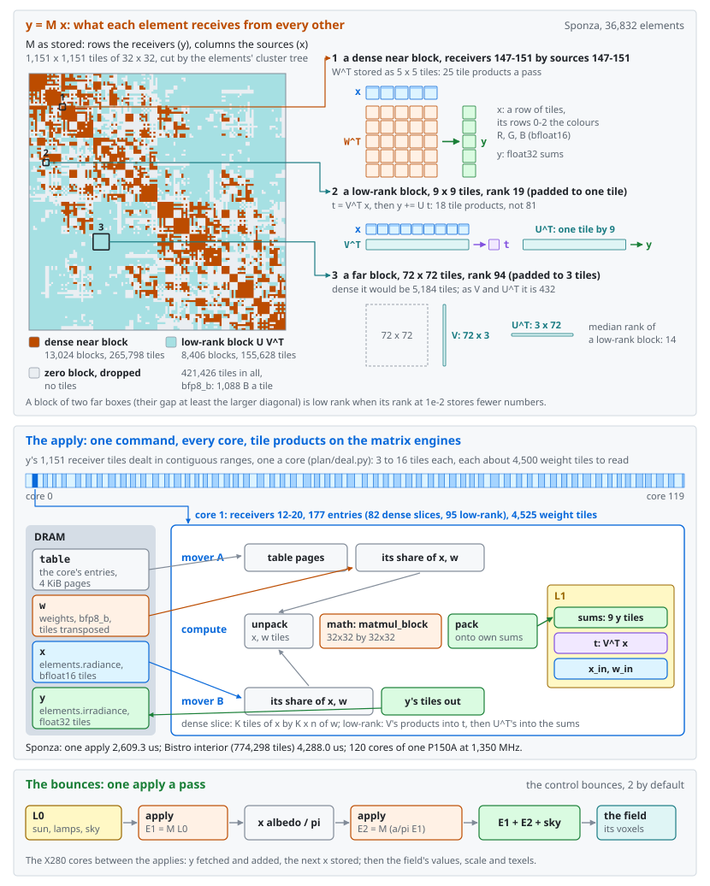
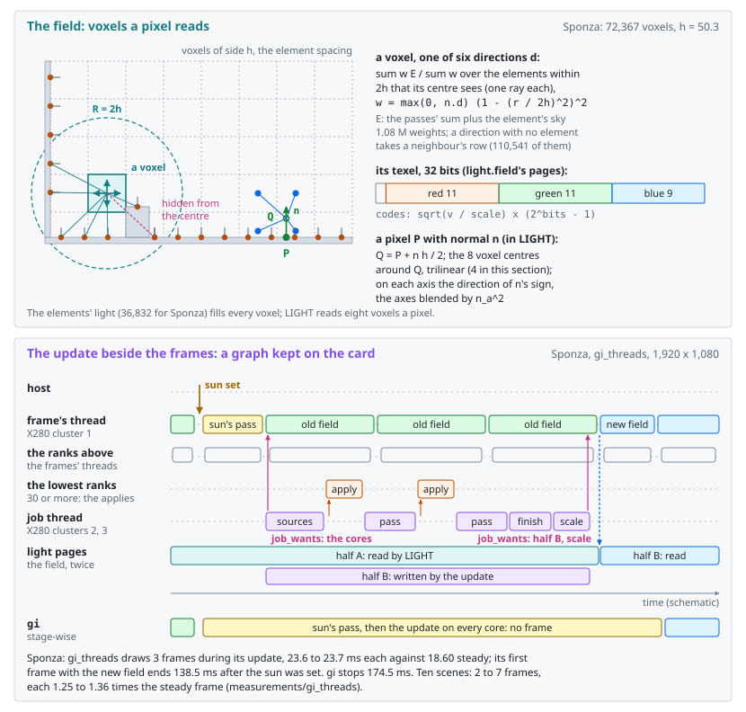

# Light transport

The indirect light of the presets `gi`, `gi_tile` and `gi_threads`: light bounced between
the scene's surfaces and the sky with its visibility, in place of a constant ambient and
the sky's baked visibility. It is made of a scene's **elements**, a **transport matrix**
between them stored as blocks and applied on the card's matrix engines, and a **field**
that LIGHT reads at each pixel and that the card makes again itself when the sun moves.
The algorithm, its rules and its error against a traced truth are in
[the indirect reference](../internals/reference/indirect.md); this page says what the
parts are and where each runs.

## The parts

| part | what it is | made |
|---|---|---|
| elements | points sampled over the surfaces by area (the lighting entry's count, 50,000 by default, then those that see only the void or are buried dropped; 36,832 kept for Sponza), each with a position, a normal, an albedo or an emission and a sky transfer row (25 spherical harmonics' coefficients over the 1,024 stratified cosine rays from the element that escape: one in each cell of a 32 x 32 grid); padded to whole units of 32 and ordered by a cluster tree | once, on the host, by `public_scenes.py indirect <scene>` (the far field: until it is made, `gi` and its forms draw the scene without the indirect light, [presets](../guides/cli.md#the-presets)) |
| the transport matrix `M = pi F` | what each element receives from every other: `F` the form factors with one visibility ray each, stored as a hierarchical matrix; built dense then compressed, or block by block without the dense matrix (`--transport sketch`) | once, with the elements |
| the sources `L0` | each element's outgoing light for the current lights: emission, and albedo / pi times the sun (through the shadow map), the lamps and the sky | at every update |
| the bounce passes | `E1 = M L0`, `E_k = M (albedo / pi E_(k-1))`, `E = E1 + ... + E_b`, `b` the control `bounces` (2 by default) | at every update, each one apply |
| the field | voxels of the element spacing, six directions a voxel, each holding `E` plus the element's own sky irradiance, averaged over the elements within 2 spacings of the voxel's centre that the centre sees (one ray each); texels of a has-data bit and three square-root codes, in light pages (slot `light.field`) | at every update |
| the lookup | at a pixel, the eight voxel centres around `P + n h / 2` with trilinear weights, a direction a voxel by the normal's sign on each axis | in LIGHT, every pixel |

## The matrix as blocks

<picture>
  <source media="(prefers-color-scheme: dark)" srcset="../images/transport-dark.svg">
  
</picture>

*Sponza's matrix drawn from its transport set; the apply's time from [measurements/apply](../../measurements/apply/README.md).*

The cluster tree cuts the elements into boxes; a pair of boxes far enough apart (their
gap at least the larger diagonal) is an admissible block. A block is dropped when it is
zero, stored low rank (`U V^T`) when the rank at 1e-2 of its largest singular value stores
fewer numbers than the block, and dense otherwise. The card's files are the set
`<data root>/public/<scene>_transport/` (`blocks.npz`, `weights.f32`, the vectors);
Sponza's holds 8,406 low-rank and 13,024 dense blocks, 421,426 tiles of weights
(1,726 MB as float32), Bistro interior's 774,298 tiles
([the indirect reference](../internals/reference/indirect.md)).

## The build on the host

The set is built in one of two ways ([the transport's build](../internals/reference/transport_build.md)).
The dense build (the default) evaluates every pair into an `N x N` file, reorders it into
the cluster order and takes a full SVD of every admissible block. The block-by-block
build (`public_scenes.py indirect <scene> --transport sketch`) evaluates each block where
it lies, mirrored pairs once, and compresses an admissible block at once by a randomized
range; its blocks follow the same truncation and dense rules. On 2026-11-27, 50,000
elements sampled, Sponza took 561 s dense (16 CPUs) and 78 s block by block (8 tracer
threads), an artists' scene of 8.8 million triangles 986 s and 163 s (32 threads), each
build's `y` within 2.4e-4 of the dense build's exact one
([the transport's build](../performance/transport_build.md)).

## The apply on the card

`indirect.transport` is one apply `y = M x` as one command on its cores (the class
`Apply`, one `km.kernel` handler `apply`):

- The receiver tiles (`y`'s) are dealt to the cores in contiguous ranges, the largest
  cost least (`plan/deal.py`); each core has a table of entries, in pages of 4 KiB.
- `x` (slot `elements.radiance`, bfloat16 tiles) and the weights (stored in `bfp8_b`,
  tiles transposed) stream through the movers; the compute CPUs sum each entry's tile
  products (`matmul_block`) onto the core's own sums in L1. A low-rank block is two
  products: `t = V^T x`, then `U t`.
- `y` (slot `elements.irradiance`, float32 tiles) is written from the sums.

The apply alone takes 2,609.3 us on Sponza and 4,288.0 us on the Bistro interior on
every core of one P150A ([measurements/apply](../../measurements/apply/README.md)). Inside
a frame program the class is made in its frame form: its buffers are windows over the
command space the other stages share
([indirect.transport](../../src/prism/stages/indirect/transport/README.md)).

## The update, by preset

<picture>
  <source media="(prefers-color-scheme: dark)" srcset="../images/field-dark.svg">
  
</picture>

*The field and its update in `gi_threads`, Sponza; the time axis is schematic, the numbers from [gi_threads](../performance/gi_threads.md).*

The update is the sources, one pass a bounce (an apply, then the pass on the X280:
`y` fetched and added, the next `x` stored), and the finish (the field's values by row,
its scale, its texels, its pages stored where LIGHT reads them). The X280 parts are the
field update's C, split over the four cores of its X280 cluster (in `gi_threads`, over
every core of both job clusters). Where it runs differs:

| preset | where the X280 parts run | where the applies run | what the frames do meanwhile | how the new field reaches LIGHT |
|---|---|---|---|---|
| `gi` | the frame's thread, the thread command `update` | every core | wait: the loop sends `sun`, then `update`, before the next FRAME | the host sends `field_scale` and writes LIGHT's table |
| `gi_tile` | work cluster 2, a thread of its own (`update_beside`) | every core, each apply a core step the director runs between two of its commands | go on with the old field | between two frames, one write of LIGHT's table: the new half of the field's pages, its scale |
| `gi_threads` | the job thread on work clusters 2 and 3 (the lowest answers job commands) | the lowest ranks: at least `update_cores` (30), as many as the apply's windows need to fit the command space | go on with the old field on the ranks above the update's | `job_wants` to the frame's thread: the half and the scale, given to the light step's words of the next frame |

In `gi_threads` the update is a graph kept on the card
(`src/prism/stages/indirect/field_update/graph.py`), started by the host when the loop's
sun or bounces differ from the field's and none runs:

1. `job_wants` to the frame's thread with the cores the update wants: the frame's views
   start above them from then on.
2. `field_sources` on the job thread.
3. For each bounce: the transport's `apply` queued on the wanted cores, then
   `field_pass` on the job thread.
4. `field_finish`, then `field_scale` on the job thread.
5. `job_wants` to the frame's thread with no cores, the field's half and its scale. The
   frame's thread gives them as slots `light.field` and `light.field_scale`; the light
   step's frame words (`field_first`, a unit a channel, `field_scale`) take them, so the
   next frame reads the new half.

The light pages hold the field twice: the half LIGHT reads and the half the update
writes. Each update writes the half not read and then swaps them.

## What moves the sun

The sun is a control, `direct.shadow_pcf.sun` (azimuth and elevation). When it moves:

1. The shadow host rewrites the sun's words and asks for the thread command `sun`; the
   loop sends it before the next FRAME. The frame's thread draws one DEPTH view a
   quadrant of the shadow map (in the threads' presets each view is the dispatcher's
   four phases) and the map is written in place (`light.shadow_map`). The light host
   writes LIGHT's table again with the new sun. Below the horizon nothing is sent.
2. In `gi`, `gi_tile` and `gi_threads`, the field's host sees a sun the field was not made
   for and starts the update above, which reads the new shadow map for the sources.

Until the new field is in, a `gi_tile` or `gi_threads` frame shows the new sun's direct
light with the old field.

## Measured

On Sponza at 1,024 x 1,024 the first `sun` pass of a run takes 19.18 ms
([lit_frame](../../measurements/lit_frame/README.md)) and the blocking update of `gi`
124.87 ms at 2 bounces ([gi_frame](../../measurements/gi_frame/README.md)). Beside the
frames (`gi_tile`) the update takes 130.50 to 197.84 ms on the card while 7 to 14 frames
are drawn, the longest gap between two frames 2.4 to 3.7 ms over the steady one, and the
first frame after the swap is byte for byte `gi`'s
([update_beside](../../measurements/update_beside/README.md)).

After one sun move at 1,920 x 1,080 on ten scenes, the stage-wise form stops: `gi` waits
161.6 to 471.6 ms (Sponza 174.5) from the control set to the end of its first frame at the
new sun, the update 104.5 to 181.4 ms of it on the card. The threads' form draws frames
during its update: `gi_threads` draws 2 to 7 frames with the old field, each 1.25 to 1.36
times the steady frame (the applies hold the lowest ranks), and its first frame with the
new field ends 130.7 to 780.6 ms after the control was set (Sponza 138.5); the longest gap
is the first frame at the new sun, which holds the sun's pass
([gi_threads](../performance/gi_threads.md)).
