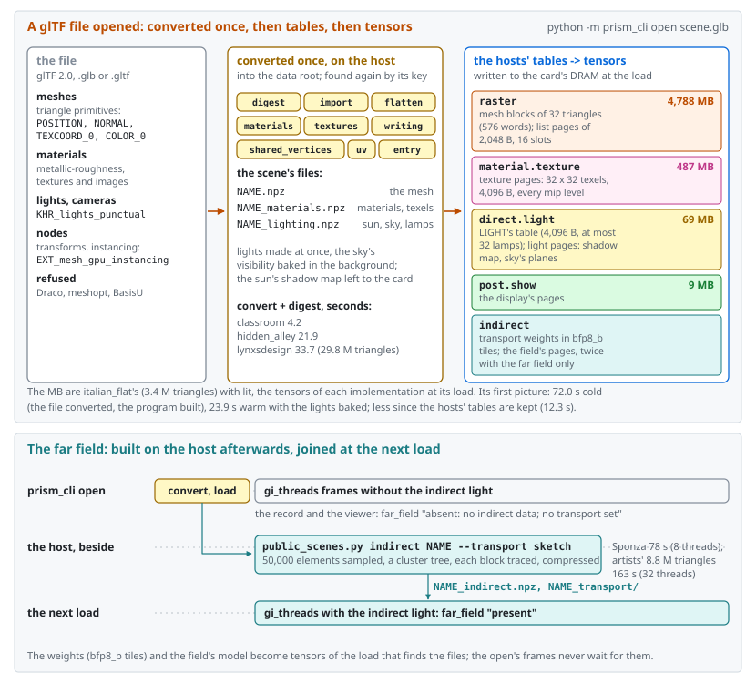

# Scenes

What `prism_reference.scene` holds: the generated scenes, the frame and the camera, the
public test scenes with their table, materials, lighting and indirect files, and the
scenes opened from glTF files, which take the public scenes' files and entries
([glTF scenes](../guides/gltf_scenes.md)). Every preset, of either form, opens a scene by
its name and a view: a generated scene by its name alone, any other by `<scene>_<view>`.

<picture>
  <source media="(prefers-color-scheme: dark)" srcset="../images/scene-dark.svg">
  
</picture>

*A glTF file opened ([glTF scenes](../guides/gltf_scenes.md)); the sizes and seconds from [load](../performance/load.md) and [the transport's build](../performance/transport_build.md).*

## Generated scenes

`python scripts/data/generated_scenes.py <folder>` writes four scenes as `.npz`;
`scene.generated.make_scene(n)` makes one in memory. A scene is spheres of mixed size (cube spheres, tessellation proportional to
area, a few large ones near the camera and many small ones far away) over a ground
grid, with per-vertex colour, one camera and one point light. Names and triangle counts:
`tiny` 398, `s10k` 11,994, `s100k` 102,308, `s1m` 997,806.

The arrays: `positions` (V, 3) float32, `colors` (V, 3) float32, `indices` (T, 3)
int32, `camera` (16,) float32 (eye, right, up, forward, focal length in pixels, principal
point, near distance; right = forward x y, up = right x forward, y up), `light` (3,) float32, `eps` (1,)
float32 (ray offset), `meta` (5,) int32. Geometry uses only addition, subtraction, multiplication, division and square
root in float64, and every random number comes from one 32-bit hash of (index, stream,
seed) (`scene.generated.hash32`, the same in `native/common/kr.hpp`), so the files are the
same on every host. Nothing is shipped: the scenes are generated.

### The frame's size

The frame is 1,024 x 1,024 unless the scene dict has a `size` entry `(W, H)`
(`scene.camera.with_size(view, size)` adds it and sizes the camera). The rule
(`scene.frame.frame_grid`): the grid is `TX = ceil(W / 32)` by `TY = ceil(H / 32)`
tiles; a side under 1 is a `ValueError` with the reason.
`rasterize`, `rasterize_shaded` and `rasterize_lighted` render the padded frame
`32 TX x 32 TY` (setup's box clipped to it, `bin_triangles` on the grid,
`tile_counts` `(TY, TX)`); `raster.frames.picture(image, scene)` is its top-left `W x H`, what
is shown and compared. The camera (`scene.camera.sized_camera`): focal length and the principal point's offset
from the centre (a view's lens `shift`, `(-x, +y)` times 1,024 at 1,024 x 1,024) times
`max(W, H) / 1024`, so the field of view spans the larger side; the principal point is
`(W / 2, H / 2)` plus that offset. At 1,024 x 1,024 every array is the same as without the entry, bit for bit
(sha256 of every output of `rasterize`, `rasterize_shaded` and `rasterize_lighted` on
`tiny`, the Sponza and Bistro interior overviews, 2026-11-24). The sun's shadow map
keeps its own 32 x 32 grids: `direct.shadow.shadow_map` builds its views without `size`.

A scene file is written beside its final name and moved into place
(`scene.files.save_beside`): a reader never sees it half written, and two makers of the
same file each move a whole one.

## Public scenes

Besides the four generated scenes, the reference runs on public demo scenes. Nothing of
them is in this repository: `scene/public/` downloads each one from its source, checks
the SHA-256 recorded in its table (`scene/public/public_scenes.json`, package data) and
converts it to the scene layout above.

```sh
python scripts/data/public_scenes.py list                  # scenes, views and attribution
python scripts/data/public_scenes.py fetch sponza          # download, check, convert (all scenes if none named)
```

Files go to `$PRISM_DATA/public/` (downloads in `downloads/`, the converted mesh as
`<scene>.npz`); each view is written as a scene of its own, `$PRISM_DATA/<scene>_<view>.npz`
and `$PRISM_DATA/<scene>_<view>/*.npy`. The reference scripts take a view name wherever
they take a scene name, and make the view from the converted mesh on first use
(`native.raster_cpu.ensure_scene`). Only the commands of `public_scenes.py` download
(`fetch` the scene, `materials` its textures, `lighting` its environment map): a script
given a scene that has not been fetched stops with an error that names the command.

### A scene's files

Each file of a scene lies under `<data>/public/` (`scene.public.files`); a preset names the
kinds it reads beside the mesh (`SCENE_FILES`, [presets](../guides/cli.md#the-presets)).
The viewer's catalog refuses a preset on a scene lacking its `materials` or `lighting`,
saying what is missing; a scene lacking `indirect` or `transport` (the far field) is drawn
by `gi`, `gi_threads` and `gi_tile` without the far field, and the record and the viewer
say what it lacks:

| kind | file | made by | missing |
| --- | --- | --- | --- |
| `mesh` | `<name>.npz` | `fetch`; the glTF conversion | no mesh file |
| `materials` | `<name>_materials.npz` | `materials`; the glTF conversion | no materials file |
| `lighting` | `<name>_lighting.npz` | `lighting`; `prism_cli open` for a preset that takes the lights | no lighting file |
| `indirect` | `<name>_indirect.npz` | `indirect` | no indirect data |
| `transport` | `<name>_transport/` (with its `blocks.npz`) | `indirect` | no transport set |

The npz files keep a JSON `counts` record (triangles, materials, textures, texel bytes,
triangles by kind, the lighting's `visibility` and `shadow`), which the viewer's scene menu
shows.

### Scenes and attribution

| name | scene | triangles | download | licence |
|---|---|---:|---:|---|
| `conference` | Conference room | 124,619 | 1.9 MB | credit required |
| `sponza` | Crytek Sponza | 262,266 | 80 MB | CC BY 3.0 |
| `bistro_interior` | Amazon Lumberyard Bistro, interior | 1,020,903 | 21 MB | CC BY 4.0 |
| `bistro_exterior` | Amazon Lumberyard Bistro, exterior | 2,833,330 | 64 MB | CC BY 4.0 |
| `breakfast_room` | Breakfast Room | 269,764 | 6.4 MB | CC BY 3.0 |
| `salle_de_bain` | Salle de Bain | 1,220,087 | 31 MB | CC BY 3.0 |
| `modern_hall` | Modern Hall | 28,655 | 5.2 MB | CC BY 3.0 |
| `modern_living_room` | The Modern Living Room | 786,480 | 22 MB | CC BY 3.0 |

Triangle counts are after conversion. Attribution, as each source asks:

- `conference`: Conference Room by Anat Grynberg and Greg Ward, from Morgan McGuire's
  Computer Graphics Archive (https://casual-effects.com/data)
- `sponza`: Crytek Sponza by Frank Meinl, Crytek (2010), from Morgan McGuire's Computer
  Graphics Archive (https://casual-effects.com/data)
- `bistro_interior`, `bistro_exterior`: Amazon Lumberyard Bistro, Open Research Content
  Archive (ORCA), (c) 2017 Amazon Lumberyard; OBJ version from Morgan McGuire's Computer
  Graphics Archive (https://casual-effects.com/data)
- `breakfast_room`: Breakfast Room by Wig42 (Blend Swap), OBJ version by Morgan McGuire,
  from Morgan McGuire's Computer Graphics Archive (https://casual-effects.com/data);
  marble texture public domain (hugolj)
- `salle_de_bain`: Salle de Bain (c) Nacimus Ait Cherif (Blend Swap), OBJ by Nicholas Hull
  (NVIDIA) and Morgan McGuire, from Morgan McGuire's Computer Graphics Archive
  (https://casual-effects.com/data)
- `modern_hall`: Modern Hall by NewSee2l035 (http://www.blendswap.com/blends/view/51997),
  Tungsten version from Benedikt Bitterli's Rendering Resources
  (https://benedikt-bitterli.me/resources/), CC BY 3.0
  (https://creativecommons.org/licenses/by/3.0/)
- `modern_living_room`: The Modern Living Room by Wig42
  (http://www.blendswap.com/blends/view/75692), Tungsten version from Benedikt Bitterli's
  Rendering Resources (https://benedikt-bitterli.me/resources/), CC BY 3.0
  (https://creativecommons.org/licenses/by/3.0/)

Pictures of these scenes made with this repository carry the same attribution.

### Conversion

`scene/importers/meshio.py` reads OBJ (with its MTL) and PLY (`scene/importers/tungsten.py` Tungsten scenes, below),
from a file or from inside a zip, tar or gzip archive, with numpy only:

- polygons are cut into fans from their first vertex;
- degenerate triangles (a repeated index, two equal positions, exactly collinear corners)
  are dropped and counted;
- a triangle's colour is its material's diffuse colour `Kd`; the scene file reads no
  texture (the materials file below does). For a material whose colour comes from a texture (`Kd` white with a `map_Kd`) the table gives
  a colour instead (`material_colours`): the mean linear colour of that texture over its
  opaque texels, times `Kd`, computed once from the downloaded textures and recorded as
  data;
- a ground plane (a 16 x 16 checker) is added under a single object when the table asks
  for it (`ground`, its half width as a multiple of the object's width).

Vertices are split by (vertex, colour), so every triangle keeps a flat colour: the
distinct (vertex, colour) pairs in the order of the vertex, then of the colour; a colour is
ranked once among the distinct colours (lexicographic), a vertex whose triangles all
carry one colour is one pair, and only the vertices between colours are sorted, so the
split is linear in the corners (`shared_vertices`). The
rasterizer has no lighting, so the colour is multiplied by a fixed shade per vertex,
`0.55 + 0.45 |n . d|` with `d = normalize(0.3, 1, 0.5)` and `n` the area-weighted
normals of the triangles around the vertex; without it a room is a few flat areas. The
ray tracer uses the same colours.

Per view the table gives the eye, the target and the field of view (square image,
1024 x 1024); the light is one point per scene. The camera's axes (`scene.public.views.camera`):
forward from the eye to the target, right = forward x y, up = right x forward, so
that with y up a point on the camera's right is on the picture's right. The ray offset `eps` is `2e-5` of the
scene's diagonal and the near distance `1e-4` of it unless the view gives `near`.

The scenes opened from a file by `prism_cli open` ([glTF scenes](../guides/gltf_scenes.md))
are added from `<data>/opened_scenes.json`. `$PRISM_SCENES_EXTRA` names a further JSON file
in the layout of `public_scenes.json`; its scenes are added after them (for scenes used
locally whose terms do not allow publishing pictures).

### Materials

Sponza and the two Bistro scenes also have their materials and textures, in a file of
their own beside the scene file, which stays as above (everything that reads
`<scene>.npz` is unchanged):

```sh
pip install -e ".[scenes]"                      # Pillow, for decoding the textures
python scripts/data/public_scenes.py materials sponza     # <scene>_materials.npz (all three if none named)
```

The command needs the scene converted (`fetch`) and the texture files of the table
(`texture_files`: the Bistro textures are three archives of their own, kept in
`downloads/textures/`, saved as the `file` their entry names: the archive serves them
without an extension); it downloads only what is missing, checked by SHA-256 like the
meshes. Pillow is the `scenes` extra of `pyproject.toml` and is imported by this
command only; without it the command stops with an error that names it.
`load_materials(name, data)` gives the arrays (a view's name works too).

| array | shape, type | content |
|---|---|---|
| `uv` | (T, 3, 2) float32 | texture coordinates of each triangle's corners, in the scene file's triangle order (0 where there are none) |
| `material` | (T,) int32 | the triangle's material |
| `light` | (T, 3) float32 | the light term of each corner, the shade the scene file's colours are multiplied by (`vertex_shade`), kept apart |
| `kind` | (M,) int32 | the material's kind of shader: 0 `flat`, 1 `textured`, 2 `masked`, 3 `lit`, 4 `emissive`, 5 `transparent` |
| `base_colour` | (M, 3) float32 | `Kd`; for `emissive` without a texture, `Ke` clamped to 1 |
| `textures` | (M, 4) int32 | the material's albedo, mask, normal and specular texture, -1 for none |
| `exponent` | (M,) int32 | the specular exponent `Ns`, rounded, 1 to 1024 |
| `specular` | (M, 3) float32 | `Ks` |
| `transmission` | (M, 3) float32 | `transparent`: the share of the light behind that passes, per channel: `1 - Tf`, else `Tr`, else `1 - d` (clamped to 0..1); 0 for every other kind |
| `texels` | (B,) uint8 | every level of every texture, RGBA8, rows from the top |
| `mip` | (N, 11, 3) int64 | per texture and level: the level's byte offset in `texels`, width, height |
| `levels` | (N,) int32 | the levels of each texture's chain |

Material 0 is `flat`: the generated ground, and every triangle without texture
coordinates or without a material. A material's kind comes from its MTL statements, in
this order: a glow (`map_Ke`, or `Ke` of 0.5 or more in a channel) makes it `emissive`,
its albedo the `map_Ke` texture; without `map_Kd` it is `flat` (the scene file's
colour); with `map_d` it is `masked` (the mask is `map_d`; when `map_d` names the albedo
image itself, the albedo's alpha); with a bump map (`map_bump` or `bump`) or a specular
map (`map_Ks`) it is `lit`; otherwise `textured`. A material whose transmission
(`1 - Tf` when the MTL gives `Tf`, else `Tr` in every channel, else `1 - d`) is above 0
in a channel is `transparent` unless it glows or is `masked` (`map_Kd` and `map_d`): it
keeps its `map_Kd` as albedo (no normal or specular map) and its transmission. `Tf` is
read as what the glass takes away because these files say so: where a material gives
both, `Tr = 1 - Tf` (0.8 and 0.2, 0.9 and 0.1, 0.61 and 0.39), and an opaque material's
`Tf` is white. A material named glass that the MTL leaves opaque keeps its kind
(below). A file written before this kind reads with a transmission of 0.

Two keys of the table's `materials` change this reading for one scene:
`black_kd_is_texture` reads a `Kd` of 0 beside a `map_Kd` as 1 (Blender's exporter
writes it so; in the Breakfast Room the floor and the picture were black; the Bistro
interior's `Metal_Chrome1` has it too and is left as it is); `emission_scale` divides
an emissive material's `Ke` by it before the clamp to 1, so emitters of different
radiance keep their ratio (the `lighting` entry's `emissive_scale` is then the same
number).

### Tungsten scenes

`scene/importers/tungsten.py` reads a Tungsten `scene.json` (the format of Benedikt Bitterli's Rendering
Resources) when a mesh entry's `member` ends in `.json`; it gives the mesh and MTL
statements of the OBJ path, so the rest is unchanged:

- primitives `mesh` (`.wo3`, Tungsten's binary mesh, or `.obj`), `quad` (side 1),
  `disk` (radius 1, 32 segments) and `sphere` (radius 1, 12 x 24) with their
  `transform` (translate, rotate about z, x, y in degrees, scale); `curves` and other
  kinds are skipped and counted (`skipped_<kind>`);
- a primitive with `emission`, or `power` (radiance `power / (pi area)`), is an emissive
  material of its own (`emitter_<number>`), facing its local +y as in Tungsten;
- BSDFs: the albedo colour or texture is `Kd` / `map_Kd`; `plastic` and `rough_plastic`
  add a specular coat (`Ks` 0.04, `Ns = 2 / r^2 - 2` of the roughness); `conductor` and
  `rough_conductor` become a plain colour (0.6 x the albedo: no reflection of the room) with `Ks` 0.9; a
  `dielectric` is transparent with a transmission of 0.92 (two faces of glass of index 1.5
  each reflect about 4 %), tinted by the medium inside
  it (`int_medium`) as `0.92 exp(-sigma_a density 0.005)` per channel; any other type is
  grey 0.7 and counted (`unmapped_bsdfs`);
- a `.wo3` triangle is turned where its winding disagrees with its corners' normals;
  Tungsten draws both sides of every surface, but the indirect light takes a triangle's
  winding as its front, so a mesh entry may also give `inside`, `{"point", "materials"}`:
  those materials' triangles are turned to face the point (The Modern Living Room's
  floor, walls and ceiling face away from the room in the file);
- the camera's position, `look_at` and `fov` (`tungsten.camera`) are the `overview` view.

Lost that way: every reflection (chrome, metal, the glossy tiles of the Modern Hall),
refraction, and the Modern Living Room's rug fibres (`curves`; the flat rug under them
stays).

Textures are stored as decoded, RGBA8; a grey image is copied into the three colours. A
texture is reduced by halving (2 x 2 box filter, rounded) until neither side is above
1,024: most of the Bistro's textures are 2,048 or 4,096 texels wide and are kept at
1,024. Its mip chain halves again down to 1 x 1 (a side of 1 stays 1). A mask keeps its
alpha when it has one that is not all opaque, else its first channel, in all four
channels. Sponza's bump maps are heights; they are turned into tangent-space normal maps
(central differences, slope gain 2) before the chain is built; the Bistro's are normal
maps already. The same image used in two roles is stored once per role.

The converted sizes: Sponza 26 materials, 37 textures, 190 MB of texels; Bistro
interior 67 and 88, 373 MB; Bistro exterior 133 and 208, 1,007 MB.

Transparent materials (MTL statements; triangles). Bistro interior, 220,840 triangles:
the bottles `Paris_LiquorBottle_01_Glass1` (`Tf` 0.03 0.05 0.04, transmission 0.97
0.95 0.96; 128,248), `_02_Glass` (`Tf` 0.2 0.1 0: 0.8 0.9 1; 51,324), `_01_Glass` and
`_03_Glass` (`Tf` 0.2: 0.8; 24,352 and 14,336), `CookieJar_Glass1` (0.9; 2,544), the
counter's `MASTER_Interior_01_Glass` (0.8; 8) and `Paris_Cashregister_Glass` (0.9; 28).
Bistro exterior, 3,778 triangles: the buildings' window panes `MASTER_Glass_Dirty`
(1,176) and `MASTER_Glass_Clean` (582) (`Tf` 0.2: 0.8), `Streetlight_Glass` (0.7; 2,016),
`MenuSign_02_Glass` (0.61; 4). Sponza has none. Named glass but opaque in
the MTL (`d` 1, white or no `Tf`, illum 2), kept as they were:
`Paris_LiquorBottle_01_Glass_Wine` (interior 28,308, exterior 3,542),
`MASTER_Interior_01_Frozen_Glass`, `Paris_Paintings_Glass`, `MASTER_Frosted_Glass`,
`Vespa_Odometer_Glass`, and the glowing `MASTER_Glass_Exterior` (window panes, 366),
`MASTER_Focus_Glass` and `Spotlight_Glass` (`emissive`).

### Lighting

Sponza and the two Bistro scenes also have the data of `rasterize_lighted`
([direct light](../internals/reference/direct.md)):

```sh
python scripts/data/public_scenes.py lighting sponza      # <scene>_lighting.npz (every scene with `lighting` if none named)
```

It downloads the scene's environment map (the table's `environments`: one HDR map per
entry, its page, licence and SHA-256; the file is saved in `downloads/` like the scene
files and never committed), bakes the sky visibility per vertex (`<scene>_visibility.npz`,
reused unless `--rebake`; traced by the compiled batch tracer (`trace.batch`, the
reference's walk and triangle test), 16,384 vertices at a time on `--workers` threads, by
default the CPUs the process may run on, at most 32), finds the lamps, renders the sun's shadow map and writes
`<scene>_lighting.npz` (to a temporary name, then renamed). With `--visibility open` and
no visibility file yet, every vertex's visibility is 1 and the file's `counts` say
`"visibility": "open"`; a later `--visibility bake` (the default) replaces it.
`--shadow card` (the default is `host`) does not render the sun's shadow map: the file
holds the map's camera and texel from the same `sun_view` the map is drawn from, its
`shadow_side`, and a 1 x 1 map of 0 in its place, and its `counts` say `"shadow": "card"`
(`"host"` otherwise). Such lights hold a placeholder (`lights.placeholder`: the map smaller
than `shadow_side`): the light pages give the map zero pages of the full count, the
pipeline's `direct.shadow_pcf` sends its SUN command at the run's first view, as after a
moved sun, so the card draws the map before the first frame is lit, and a check that
compares with the reference's map (`direct/light/model/expect.py`'s `with_map`) draws it
with `shadow_map` at that moment. A pipeline that lights without `direct.shadow_pcf`
needs `--shadow host`. The maps used:

| name | page | licence |
|---|---|---|
| `kloppenheim_05` | https://polyhaven.com/a/kloppenheim_05 (4k HDR, 4096 x 2048) | CC0 |
| `san_giuseppe_bridge` | https://polyhaven.com/a/san_giuseppe_bridge (4k HDR, 4096 x 2048) | CC0 |

A scene's `lighting` entry holds its numbers:

| key | meaning |
|---|---|
| `environment` | the map's name in `environments` |
| `turn` | degrees the map (sun, sky and background) is turned about the up axis |
| `sun_to_sky` | the sun's irradiance facing it over the sky's on a horizontal surface |
| `ambient` | constant irradiance (RGB) added everywhere, standing in for bounced light |
| `lamp_scale` | a lamp's intensity per unit of emitting area |
| `merge_distance` | lamps whose centroids are nearer than this are one |
| `radius`, `size` | a lamp's reach `r` and the `s` of its falloff |
| `emissive_scale` | the factor of an emissive material's colour |
| `exposure` | the factor of the colour before the tone curve |
| `saturation` (optional) | the tone step's saturation, default 1 (none): `max(0, lum + (x - lum) s)` ([direct light](../internals/reference/direct.md), "The tone step") |
| `curve` (optional) | the tone curve, default 0: `x / (1 + x)`; 1 the filmic fit `x (2.51 x + 0.03) / (x (2.43 x + 0.59) + 0.14)` clamped to [0, 1] |
| `shadow_bias` | the shadow test's bias, in shadow texels |
| `lights` (optional) | authored point lights, each `{"position", "colour"}`; they replace the emissive groups, each of intensity `lamp_scale` (an empty list: none) |
| `shadow_side` (optional) | the sun's shadow map side, 1,024 or 2,048 (default): 2,048 is four FILLs of 1,024, one a quadrant |
| `sky_side` (optional) | the side of the background's octahedral map, default 2,048 (4k files and 2,048: a texel about 0.1 degrees against a frame pixel's 0.07; 1k and 512 were blocky) |
| `reflection` (optional) | the factor of the environment's radiance a glass surface reflects ([direct light](../internals/reference/direct.md), "Glass"), default 0 (`direct.lights.load` reads it; a caller may set it in the lights) |
| `sun` (optional) | an authored sun, `{"direction"` it shines along`, "colour"}`; the map is turned so its sun's azimuth matches, and `turn` is not used |
| `elements` (optional) | surface elements sampled for the indirect light (`python scripts/data/public_scenes.py indirect`), default 50,000 |
| `bounces` (optional) | the indirect light's bounce passes summed, 0 or more, default 2 (0: only each element's own sky; [indirect light](../internals/reference/indirect.md)); a caller may override `lights["bounces"]` |

Chosen by looking at the pictures: Sponza `turn` 0, `sun_to_sky` 5, `ambient` 0.35,
0.33, 0.30 (the courtyard's sky visibility per vertex is low, so bounced light is most
of the shade), `shadow_bias` 3 (with the 2 x 2 filter; 1 left acne on the fabrics),
no lamps. Bistro interior: the four authored point lights, `lamp_scale` 100,000,
`radius` 900, `size` 10, `ambient` 0.01, `emissive_scale` 6, `exposure` 1. Bistro
exterior: the authored sun, the `san_giuseppe_bridge` map, no point lights (`lights`
empty), `sun_to_sky` 5, `ambient` 0.3, `exposure` 1.

The Bistro's `lights` and `sun` are numbers taken from the scene's original package
(Amazon Lumberyard Bistro, Open Research Content Archive (ORCA), (c) 2017 Amazon
Lumberyard, CC BY 4.0; its FBX files, read once and converted to this scene's
coordinates: interior x 100, exterior x 62.5): the interior's four point lights, one
in each ceiling lamp, colour (0.702, 0.566, 0.310), and the exterior's directional
light, colour (0.734, 0.583, 0.377), shining along (0, -0.876, -0.482). The package
gives an intensity whose unit is not verified, so brightness is `lamp_scale` and
`sun_to_sky` here. Its README says the analytic lights are for rasterizing and the
emissive surfaces for ray tracing.

Breakfast Room: an open window with blinds and no glass; the `san_giuseppe_bridge` map
turned by -134.1 degrees, so its sun (28.6 degrees high) comes through the blinds onto
the table and the floor; `sun_to_sky` 5, `ambient` 0.05, no lamps. Salle de Bain: its
window is covered by an emissive quad (`Ke` 10) that blocks the sun and the sky;
`emissive_scale` 10, `lamp_scale` 0 (no point lights: the quad lights the room through
`indirect`). Modern Hall and The Modern Living Room: lit only by their emitters (13 in
the hall: ceiling disks, step lights and window quads; one sphere lamp in the living
room), `sun_to_sky` 0, `lamp_scale` 0, `emissive_scale` the largest emitter's radiance
(4.575 and 114.4). The living room is open on the camera's side, so the sky still lights
it there; Tungsten renders it without a sky. These four take the filmic tone:
`exposure` 2, `saturation` 1.15, `curve` 1; the other scenes keep the plain curve.

### Indirect light

For the optional term `indirect` of `rasterize_lighted` ([indirect light](../internals/reference/indirect.md)), after `lighting`:

```sh
python scripts/data/public_scenes.py indirect sponza                      # the dense build
python scripts/data/public_scenes.py indirect sponza --transport sketch   # block by block
```

The transport has two builds ([the transport's build](../internals/reference/transport_build.md)).
The dense one (the default) evaluates every pair of elements into an `N x N` file and
takes an SVD of every admissible block; the block-by-block one (`--transport sketch`)
evaluates each block where it lies and compresses it at once, without the dense matrix.
On 2026-11-27, 50,000 elements sampled, the block-by-block build took 78 s on Sponza
(8 tracer threads) against the dense build's 561 s (16 CPUs), with the same error against
the dense `F` ([measurements](../performance/transport_build.md)). Either writes `<scene>_indirect.npz` (the elements in the matrix's order, their transfer
rows of the sky, the field's sparse matrix and grid, `counts` with the times and sizes),
the card's matrix files in `<scene>_transport/` (`blocks.npz`, `weights.f32`, `x.npy`,
`y_exact.npy`, `y_float.npy`, `y_q8.npy`, `perm.npy`, `README.md`: the layout the
stage `indirect.transport` reads; the block-by-block build writes no `y_exact.npy`, there
being no dense matrix to apply). The dense build keeps the dense form factors in
`<scene>_indirect_work/` (`F.npy`, about 6 GB at 40,000 elements; a stopped build goes on
from it; it may be deleted afterwards). `direct.lights.load` finds the indirect file by its name. Built, with
their elements and `weights.f32`: Sponza (36,832 elements, 1.7 GB), the Bistro interior
(42,240, 3.2 GB), the Breakfast Room (27,136, 1.4 GB), the Salle de Bain (47,072, 2.4 GB),
the Modern Hall (48,640, 2.8 GB) and The Modern Living Room (48,896, 2.4 GB). The presets
`gi`, `gi_threads` and `gi_tile` read both the indirect file and the transport set; on a
scene without them they draw without the far field, their pictures the lit presets'
([presets](../guides/cli.md#the-presets)).

### Limits

Not represented: refraction, glass behind glass (one transparent layer: the nearest),
coloured shadows (transparent triangles cast none; the baked sky visibility still treats
them as opaque), the scenes' own lights outside
`rasterize_lighted` (one point light per scene; emissive materials are drawn unlit and
light nothing). Without the materials file, as in the ray tracer,
textures are represented by their mean colour and foliage cut out of quads is drawn as
whole opaque quads. In the scenes added from the archive and from Bitterli's resources: mirrors
and metals have no reflection (the Salle de Bain's `Mirror` material, `Kd` 0, covers
342,368 triangles, the taps among them, and is drawn black; the Breakfast Room's chrome
chair legs are black; the Modern Hall's glossy floor tiles are a diffuse texture with a
specular term), the Modern Living Room's rug fibres, and Tungsten's own lights' exact
shapes beyond the triangles of `tungsten.unit_shape`.
