# The viewer

A page in a browser steers the camera, chooses the pipeline, the scene and its view, and
shows the frames a card renders through `prism.loop`. Two halves: the server
(`apps/prism_viewer/server/`), which owns the card's session and the loop, and the page
(`apps/prism_viewer/web/`), a Vue 3 + Vite project in KohakuTerrarium's design language.

Nothing in either half names a stage. The pipelines offered are the presets of
`configs/pipeline/` that are given the slot `view.camera`: the renderer's threads' presets
`textured_threads`, `lit_threads` and `gi_threads`, the stage-wise presets their pictures
are compared with (`raster`, `textured`, `lit`, `gi`, `lit_tile`, `gi_tile`)
([presets](cli.md#the-presets)), opened as the command line opens them
(`prism_cli.preset.opened`). A preset that takes inputs from a scene's view
(`SCENE_INPUTS`: materials, lights) is refused on a generated scene ("a generated scene
has no view to take ... from"), and a preset that reads a scene's files beside its mesh
(`SCENE_FILES`, the kinds of `prism_reference.scene.public.files`: `materials`,
`lighting`, `indirect`, `transport`) is refused on a scene that lacks one, with the
reasons joined ("no lighting file", "no indirect data; no transport set"). The catalog
says so for every scene and preset, so the page never offers a choice the server would
refuse. The controls are the loop's (`Loop.controls()`: the hosts', named
`<implementation>.<name>`); the card's times are the loaded run's columns by name, a
layer unit's by layer (`part`, `part.<i>`).

## Starting it

Build the page once (Node and npm on the PATH):

```
cd apps/prism_viewer/web
npm install
npm run build          # dist/, which the server serves
```

Start the server on a card (the environment of any card run, as the README's "Running it"
installs it, and `$PRISM_DATA` ([environment](environment.md)); Pillow, the `viewer`
extra, for the JPEG frames):

```
python -m prism_viewer.server --host 127.0.0.1 --port 8790 --token TOKEN \
    --pipeline lit_threads --scene sponza --view overview [--size W H] [--card 0] \
    [--offer NAME ...]
```

`--offer NAME [NAME ...]` limits what the page is offered: only those presets, and only
the scenes at least one of them can run on (the catalog's reasons decide it); `--pipeline`
must be one of them, and the server refuses any other choice as it refuses an unknown
preset or scene. Without it every preset and scene is offered. The defaults are `--pipeline raster
--scene tiny` (a generated scene) and the size 1,024 x 1,024. The scene menu drops its
Presets column when it would say nothing: every preset offered of one family (the name
before its first `_`: `--offer gi gi_threads`) and running on every scene listed.

Open `http://127.0.0.1:8790/?token=TOKEN`. Every route under `/api` answers 403 without
the token (`?token=` on a GET, the header `X-Token` on a POST); the page keeps the token of
its address. `?theme=light` or `?theme=dark` picks the theme for that visit. SIGINT or
SIGTERM stops the loop and closes the card's session before the process exits.

While working on the page, `npm run dev` serves it on port 5173 and proxies `/api` to the
server named by `PRISM_VIEWER_API` (default `http://127.0.0.1:8790`).

## The path of a frame

The page posts a pose (position, yaw, pitch, field of view) -> the server keeps the
newest -> the render loop, on the process's main thread, makes the camera from it
(`server/camera.py`; the view's own camera while the pose is the view's) at the frame's
size -> `Loop.frame` (the
hosts' views, the thread's FRAME command) -> `Loop.picture` (only the last host that gives
pictures is asked) -> the encoders -> JPEG -> the page's multipart stream (`GET
/api/stream`). The loop makes frames one after another while a stream is being read (a
page is open), at the newest pose; with no stream read, one frame when something is
asked and one a second otherwise.

The render loop does not encode. Its period is the frame, the picture and the hand-over,
nothing else. `Loop.picture` is how the host has the picture (the display stage waits for
the image the card pushes and lays its pages into one image it keeps; it reads the
display back only without its push): the server does not know which, and times it as
"picture". That image is valid only until the next frame, so the loop copies the
picture's colour of the frame's size (`encode.held`: the image as it is, four bytes a
pixel; part of "picture"), hands it
with its pose's serial and its times to the encoders (`server/encoders.py`) and goes on
to the next frame at once. The locks it takes between frames (the state's, the
encoders') are held for a swap or an append, never across an encode, a copy or a socket
write. One picture
waits at most: a picture handed over while the last one still waits replaces it (the
newest pose wins; the replaced are counted). Each encoder is a thread that takes the
waiting picture and writes its JPEG into an unlinked file of its own in memory (a tmpfs,
`encoders.MEMORY`; a picture a frame never goes to a disk; without it the encoder writes
into the process's memory: correct, but one encode at a time): Pillow's JPEG
encoder holds the interpreter's lock when it writes into memory (two threads encoding
into a `BytesIO` take longer than one) and lets it go when it writes to a file, and
the bytes are the same. The four-byte image is given to Pillow as it is (`RGBX`, no copy):
taking the three colour bytes out with numpy first cost more than the encode itself.
The encoders' count follows the numbers: the median
encode over the median time between hand-overs (the last 16), rounded up, at least one
(`LEAST_ENCODERS`) and at most the CPUs the process is allowed but one; a thread is added
when the numbers ask for it.

The JPEGs reach the stream in the order the pictures were handed over: one that finishes
after a newer one was shown is dropped. A size, a control or a new choice applied by the
render loop drops every picture handed over before it (in flight or waiting), so no
picture of an older size or setting is served after the change; the stop joins the
encoders. The stream sends the newest JPEG whenever one is newer than the last it sent: a
client that cannot keep up skips to the newest, and only its own connection waits for it.

Requests are applied between frames: a size (`Loop.resize`: a reload only past the
capacity held; a refused load opens the loop again at the size before, with the reason in
a notice; a reopen starts again at the view's own pose), a choice (a new session and
loop), a control (`Loop.set`: applied live, or a reload when the host asks for one). A
control's request is answered once the render loop has applied it (at most a minute): 200
when applied, 400 with the reason when its kind or limits refuse the value or the host
refuses it (the page then shows the reason as a notice and the control the server's value
again). The sun of `lit` is applied live: the loop sends the sun's pass before the next
frame; the bounces of `gi` likewise send the field's update again.

## What the page shows

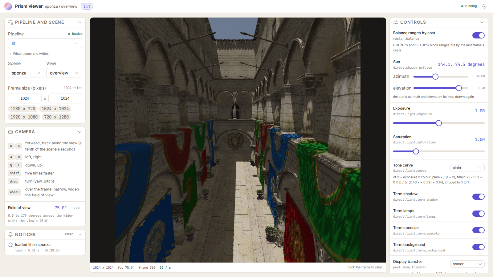

From 1,280 px wide the page is the window's height and does not scroll: a left column
(what is chosen and how to steer: the pipeline, scene and view, the frame's size, the
camera's keys and field of view, the notices), the frame, a right column (what is tuned
and measured: the controls, the numbers); each column scrolls inside itself, and nothing
is under the frame but its status line. Narrower, one column: the frame, then the left column's panels, then
the right's. Every panel folds; the browser keeps what is folded.

- **The frame**, letterboxed on a dark stage, its size, the pose's field of view, the
  frame number, the pictures served a second, and the pose while the frame has the keys (an iolite ring), else "click
  the frame to steer". A load shows over the frame while it runs; a failure shows its
  message there.
- **Pipeline and scene**: the preset (its line and the slots it writes, behind a
  disclosure that is closed at first and remembered; a preset that cannot run on the
  chosen scene is disabled with its reason), the scene (the scene menu, below) and its
  view; a sage "loaded" mark while the choice is the loaded one, Load when it differs; the
  frame's size with four common sizes, Apply when the typed size differs, and the capacity
  held (tiles, wide).
- **The scene menu**: a button with the chosen scene's name and format (under it its
  triangles, textures and source file) opens a table of every scene the catalog lists,
  as wide as the window allows, with a filter box (name, format, source file, layer) and
  a column sorted by a click (again: the other way; an unknown number sorts last):

  | column | what | from |
  | --- | --- | --- |
  | Scene | the name, under it the source file (its folder and name) and its size | the table entry's `source` (`gltf_scenes.md`), else the public table's mesh file |
  | Format | `glTF opened`, `glTF converted`, the test scenes' own (`OBJ`, `Tungsten`), `generated` | the entry: `opened`, `source`, `meshes` |
  | Drawn, Stored | triangles drawn (the mesh file) and stored once in the source file | the mesh file's `counts`; `source.stored_triangles` |
  | Objects, Instances | the source file's nodes that draw a mesh, and the copies they draw | `source.objects`, `source.instances` |
  | Materials, Textures | materials, textures and the MiB of their texels | the materials file's `counts` |
  | Layers | opaque, masked, glass: the layers its triangles make | `counts.triangles_by_kind` |
  | Lighting | the lighting file's sky visibility: `baked`, `open` (1 everywhere), `none` | the lighting file's `counts` |
  | Views | the scene's views | the entry |
  | Presets | each family (`raster`, `textured`, `lit`, `gi`; its forms on hover); one that cannot run struck, its reason on hover | the catalog's `refusals` |

  A number a scene's files do not record is shown as "unknown", never 0. Choosing a scene
  the chosen preset cannot run on switches to the preset that can and reads the most of
  the scene (of the same form, `_threads` or `_tile`, when one can), and a notice says so;
  the arrow keys and Enter choose from the keyboard, Escape closes it.
- **Camera**: the keys (below), then the pose's field of view in degrees with a "reset" to
  the view's own (dimmed while the pose has it), the range offered and the view's own.
- **Numbers**: pictures served a second, the frame command's ms, the picture's age; a
  line with the frames the loop made in the last second, the pictures served and those
  replaced before encoding (amber while some are), the picture's ms, the encoders'
  count and the encode's ms (`made_fps`, `fps`, `replaced_fps`, `encoders` and `times`
  of `/api/state`, which also gives `replaced`, the count since the start). The last
  picture's parts (frame, picture, encode: the encode runs beside the next frames) as
  a stacked bar;
  the card's own parts as a table: the thread's time columns, medians over the last 32
  frames of the run before (they are read when a run stops: after a reload or a new load),
  each with a bar against the whole frame's; the parts under 5 % of the frame are folded
  into one line ("N more parts, each under 5% of the frame") that opens them.
  A host that gives readings (`readings()`: a title, named values, what it cannot give
  live) has them shown under its title: for `gi` the field's updates, the passes of the
  last and its round trip on the host (the card's time of an update is read only when
  the run stops); for every preset the display's: how the picture reaches the host
  (pushed by the card, or read back) and the last wait for the push.
- **Controls**: one row a control, drawn from what the server lists
  (`prism.core.control.Control`), by its kind and limits:

  | kind | value | drawn as |
  | --- | --- | --- |
  | `toggle` | true or false | a switch |
  | `range` | a number within (least, most) | a slider (by the logarithm when the limits are positive and the most is at least 100 times the least, as the exposure's) |
  | `count` | a whole number within (least, most), or least or more when its most is none | a stepper (its line "0 to 3" or "0 or more") |
  | `choice` | one of its (value, label) pairs' values | a menu of the labels; the value is sent |
  | `direction` | two angles, each within its own (least, most) | two sliders (azimuth, elevation) |

  For `lit`: the raster's balance, the sun (azimuth 0 to 360, elevation 0 to 90), the
  exposure, the saturation, the tone curve (plain or filmic, its formulas in its help)
  and each switchable term (shadow, lamps, specular, background); `gi` adds the indirect
  switch and the bounces (the field's H-matrix passes, 0 or more). Every preset ends in
  the display stage, which gives the display's transfer (power, the default, or the
  standard piecewise sRGB) and the power's gamma (1.0 to the most the display's
  conversion holds, 3.55: the largest gamma whose first threshold stays over the
  writer's bucket base, 2^-32, the lowest its buckets' page holds; the writer fills
  the buckets from the first threshold's, so a higher gamma costs SHOW more; default
  2.2, the table the checks are made on). A change makes the
  thresholds' table again and writes it for the next frame (SHOW reads it at each
  command); the checks and references stay on the default.
- **Notices**: the last five, newest first, with "clear": loads and reloads with their
  seconds (a frame recovered by a reload names the code), lists grown live (a threads'
  preset whose frame needed more list slots than the load gave: the code's name, the
  view that stopped, each layer with its slots before and after, the milliseconds; [the
  raster model](../internals/raster/model.md#the-lists-slots-a-load-holds)), applied
  changes, refusals with their reasons, failures.

The colours hold one meaning each: iolite the primary action and selection; sapphire the
card's time; amber the host's time; aquamarine a rate; taaffeite the frame's size,
capacity and age; coral a refusal or failure; sage a healthy state.

| | |
| --- | --- |
| lit, light, 1280 x 800 (the narrowest with the columns) | 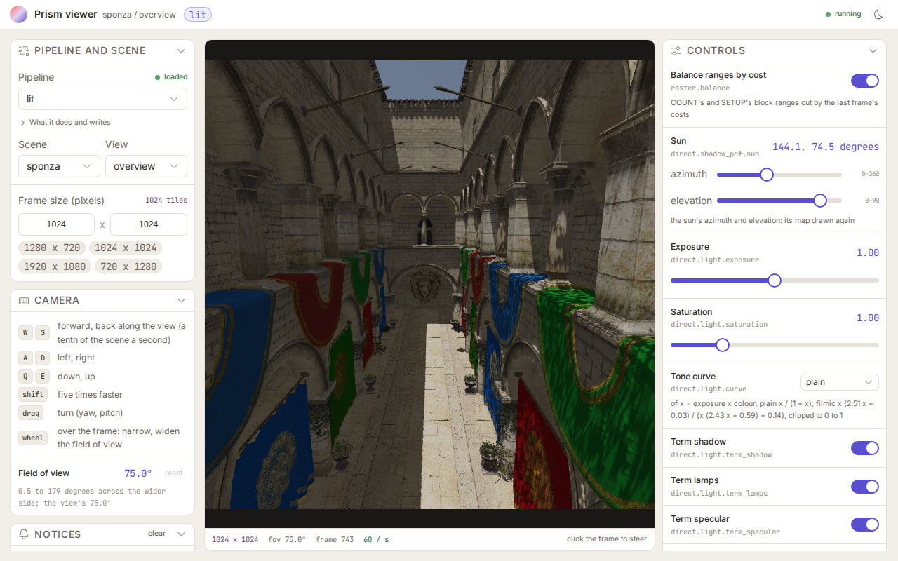 |
| gi, dark, 1600 x 900 (the bounces a stepper) | 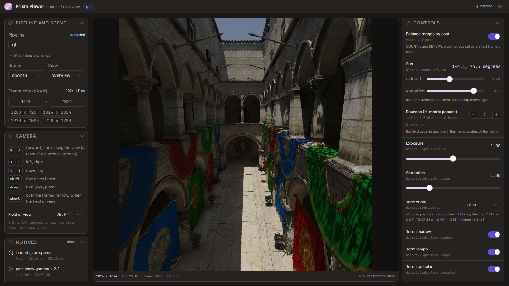 |
| gi, dark, 1280 x 800 | 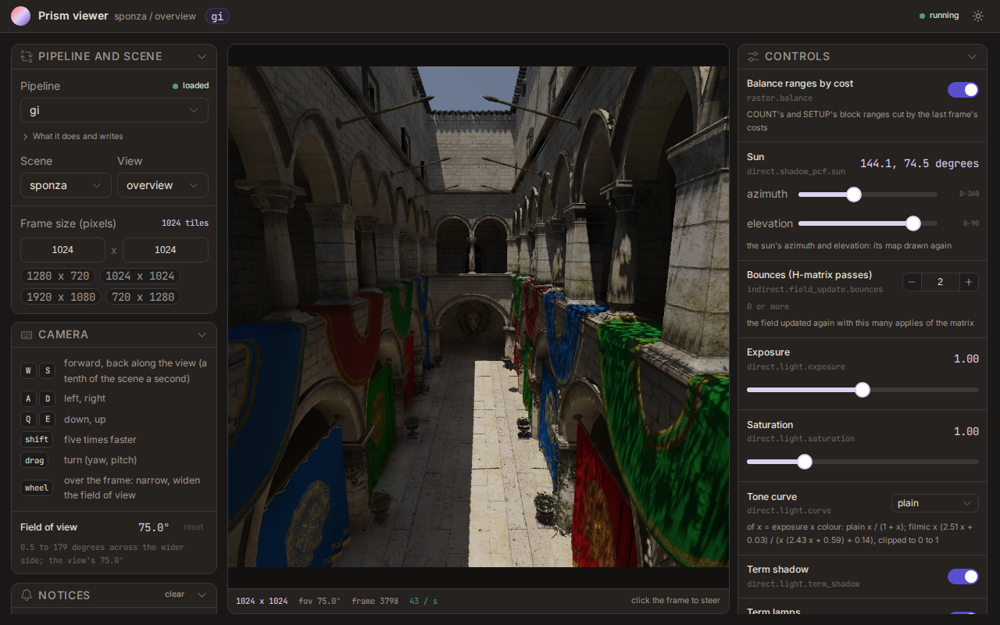 |
| gi, light, 1600 x 900, the right column scrolled: the numbers, the field update's and the display's readings, the card's parts of the run before | 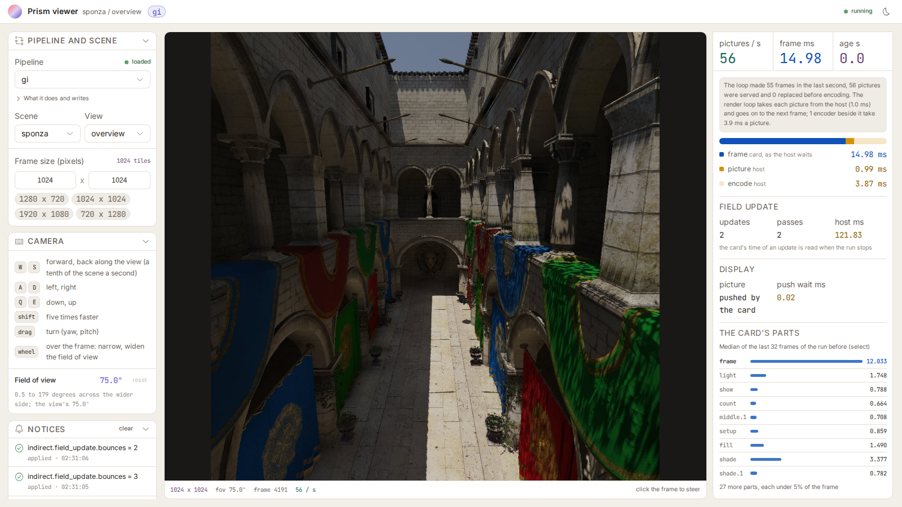 |
| lit, light, 900 x 1200 (one column: the frame, then the panels) | 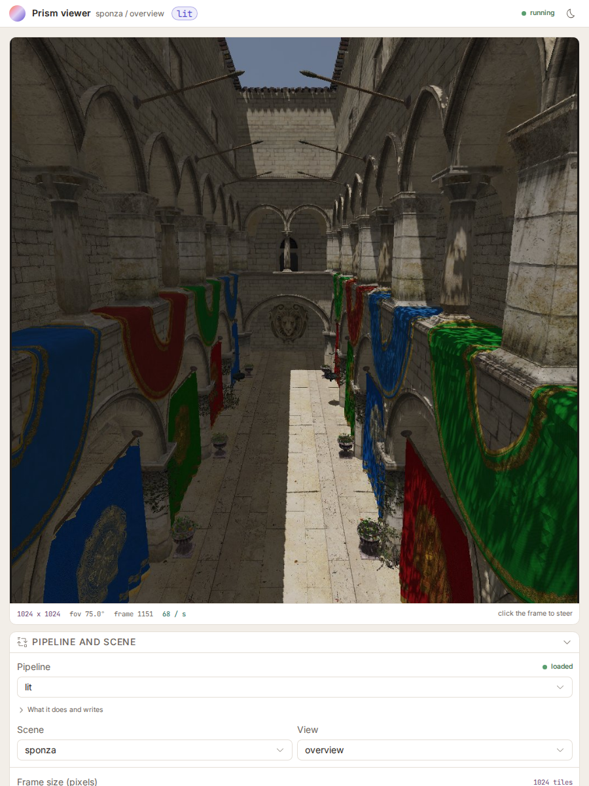 |
| lit, dark, 1600 x 900, the gamma at 1.6 (the right column scrolled: the display's controls) | 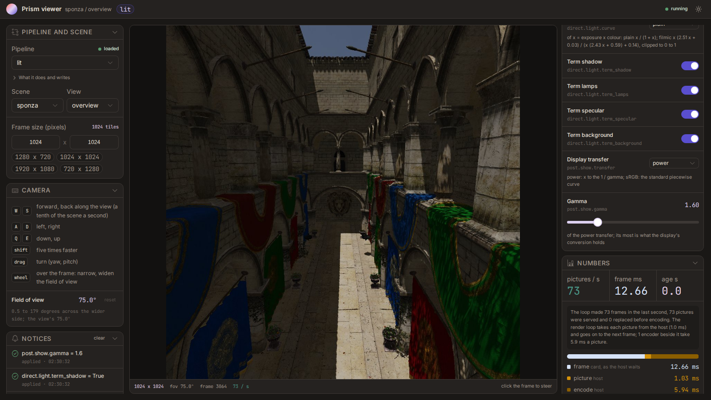 |

## The keys

Click the frame first.

| key | does |
| --- | --- |
| W, S | forward, back along the view |
| A, D | left, right |
| Q, E | down, up |
| shift | five times faster |
| drag | turn: yaw and pitch, the shown frame's width half a turn |
| wheel | the field of view: up narrows, down widens (a factor of 1.1 a notch) |

A step is a tenth of the scene's box diagonal a second. The page posts the pose at most 60
times a second, and only when it changed.

### The field of view

The pose's field of view is in degrees, the angle a view's own `fov` is in the scenes'
table: across the reference width, so across the frame's wider side (a frame's focal is
the view's scaled by its wider side, `sized_camera`). A pose made from a camera takes its
field of view from the camera's focal, `2 atan((WIDTH / 2) / focal)`; a pose's camera
takes the focal `(WIDTH / 2) / tan(fov / 2)`. A pose equal to the view's own (its field of
view included) is rendered with the view's own camera, unchanged. A posted pose without a
`fov` keeps the one before, so a client that does not know it still steers.

The wheel over the frame narrows the field of view (wheel up) or widens it (down) by a
factor of 1.1 a notch; in the one-column layout, where the wheel scrolls the page, only
while the frame has the keys. The Camera panel shows its value with a "reset" to the
view's own. A new load starts at the view's own.

The range offered is 0.5 to 179 degrees (`FOV_LEAST`, `FOV_MOST` in `server/camera.py`;
a request outside it is answered 400 with the range). The formula holds any angle over 0
and under 180; the ends are the widest and the narrowest tried on the card, and both hold:
`lit` on sponza and bistro_exterior, each at 1,024 x 1,024 and 1,920 x 1,080, at the
view's own pose with 179, 178, 170, 150, 120, 100, 75, 50, 30, 15, 8, 4, 2, 1 and 0.5
degrees: every frame code 0, no retry, no reload (the raster's lists held at both ends),
and the picture against the reference as at the view's own field of view (the runs'
records: [measurements/viewer/](../../measurements/viewer/README.md)):

| scene, size | fov (own: sponza 75, bistro 70) | share over 2 | share over 8 | largest error |
| --- | --- | --- | --- | --- |
| sponza, 1024 x 1024 | 0.5 / own 75 / 179 | 0.0005 % / 0.046 % / 0.65 % | 0 / 0.011 % / 0.11 % | 8 / 75 / 33 |
| sponza, 1920 x 1080 | 0.5 / own 75 / 179 | 0.0001 % / 0.052 % / 0.42 % | 0 / 0.010 % / 0.079 % | 12 / 85 / 66 |
| bistro_exterior, 1024 x 1024 | 0.5 / 75 / 179 | 0.15 % / 0.42 % / 1.2 % | 0.0004 % / 0.023 % / 0.15 % | 24 / 110 / 82 |
| bistro_exterior, 1920 x 1080 | 0.5 / 75 / 179 | 0.15 % / 0.45 % / 0.63 % | 0 / 0.023 % / 0.054 % | 8 / 106 / 77 |

Past about 170 degrees the picture is mostly the stretched edges of the frame; under a
few degrees it is a few texels magnified.

## The presets

| | |
| --- | --- |
| lit, sponza, the default sun | 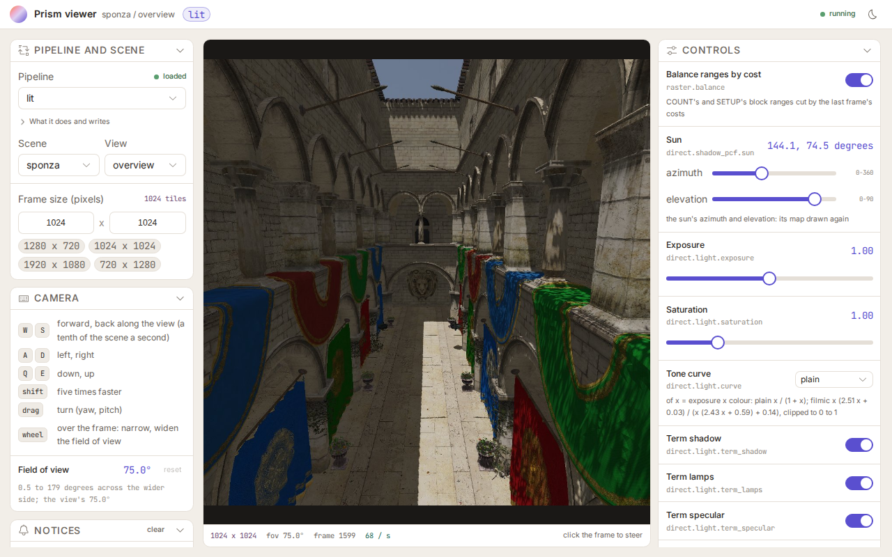 |
| lit, the sun moved (azimuth +60, elevation 30) | 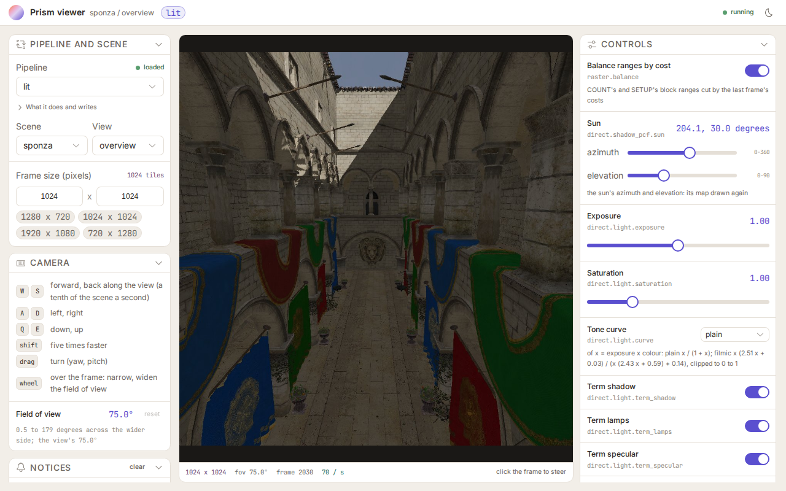 |
| lit, the shadow term off | 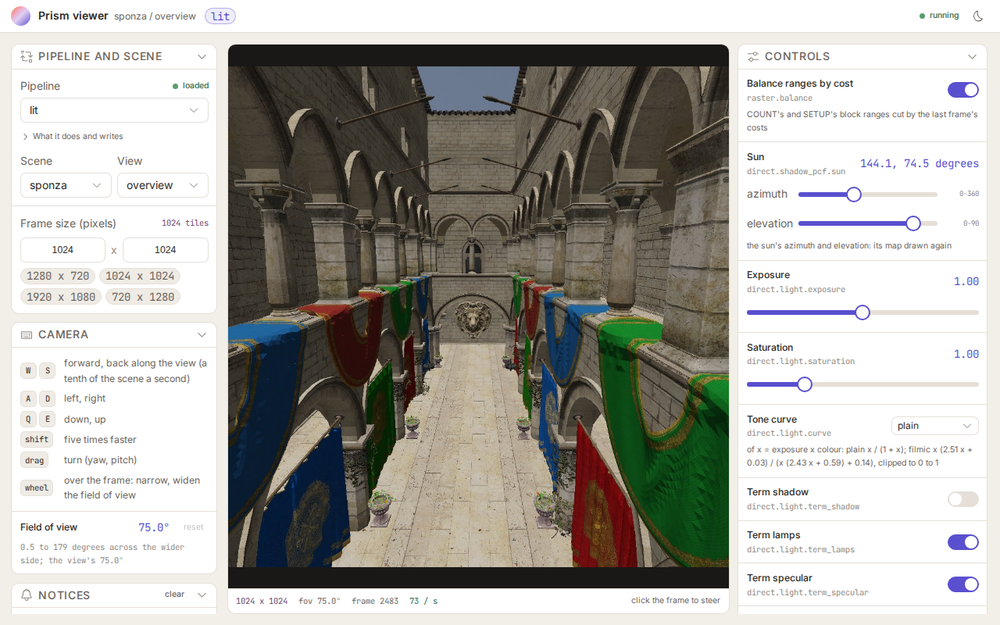 |
| textured, bistro_interior | 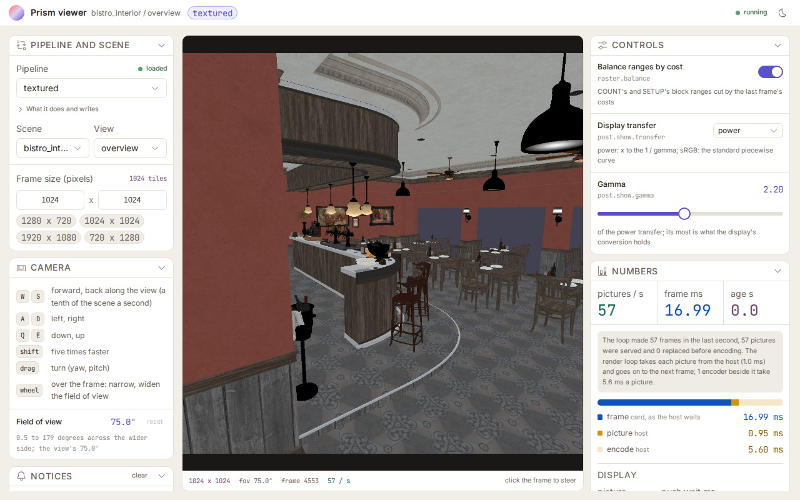 |

## Credits

The pictures on this page show two public scenes, credited as their sources ask (all the
scenes and their licences: [Scenes and attribution](../concepts/scenes.md#scenes-and-attribution)):

- Sponza: Crytek Sponza by Frank Meinl, Crytek (2010), from Morgan McGuire's Computer
  Graphics Archive (https://casual-effects.com/data), CC BY 3.0.
- Bistro interior: Amazon Lumberyard Bistro, Open Research Content Archive (ORCA), (c) 2017
  Amazon Lumberyard; OBJ version from Morgan McGuire's Computer Graphics Archive
  (https://casual-effects.com/data), CC BY 4.0.

## Checking it

```
python -m prism_viewer.server.check --pipeline lit --scene sponza --view overview
```

starts the server on the card, checks 403 on every route without the token, reads the
state and the catalog, posts 20 poses and reads their frames from the stream, posts two
sizes (one past the capacity: a reload), refused requests; then, at the view's own pose,
moves each control the loop lists (a toggle flipped, a range half as much again, a count
one more, the next choice, a direction's azimuth turned by 60 degrees), reads a frame after
it and moves it back; then each kind's own checks (`server/check_kinds.py`): a direction's
elevation moved within its limits (a picture) and one past them answered 400 with its
reason; a choice's labels listed; a count set to its least (one with no most, as the
bounces, also to 3 over its value) and back, each time one update more in the host's
readings with that many passes, and the picture after the last the one as loaded; then
the pose's field of view (`server/check_fov.py`): the view's own pose at two thirds and
four thirds of its field of view, then posted without one (the wider is kept), then at
its own again (the picture as loaded). It stops the server with SIGTERM (exit 0).
It then opens the loop itself at that size and, for the frame as loaded, each control
moved and each field of view at its pose, checks two things: the
picture the server sent is the loop's picture (the JPEG decoded against the loop's picture
passed through the same encoder at the same quality: a mean absolute difference of at most
0.5 of 255, and another pose's must be further), and the loop's picture is right (the
preset's `JUDGE` against its `REFERENCE` at that setting, its numbers reported as
`prism_cli run` reports them). The record also gives each picture's difference from the
one as loaded (what the control changed) and the JPEG against the unencoded pictures. One
JSON line; exit 1 on a failure.

Its options: `--pipeline` (default `raster`), `--scene` and `--view` (default `sponza`,
`overview`), `--port` (8791), `--card` (0), `--log FILE` (the server's output) and
`--no-reference` (the loop's pictures not judged by the preset's `JUDGE` nor
`REFERENCE`, whose host-made frames take long on a scene of millions of triangles; every
pass or fail stays). A threads' preset is checked the same way (`--pipeline lit_threads`),
an opened glTF scene with `--view camera` ([glTF scenes](gltf_scenes.md)).
