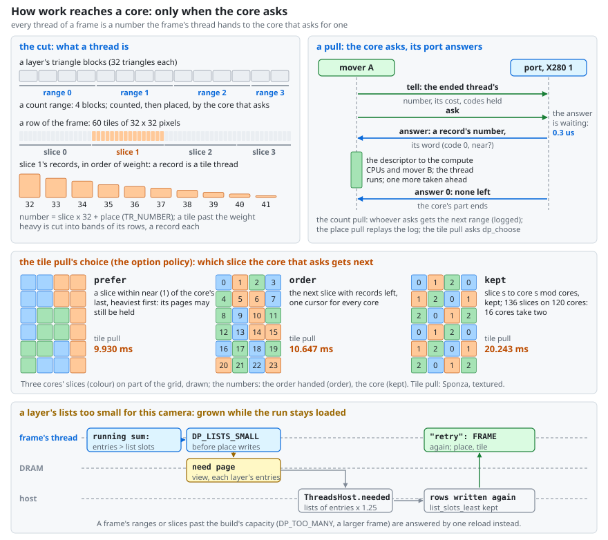

# The dispatcher: a view as pulls

In the threads' form a frame is run by the frame's thread, Komorebi's X280 thread on work
cluster 1 (`prism.core.unit.FRAMES`), and every view of the frame is four pulls and one
command that the frame's thread hands to the cores. This page is the frame's thread's
side: what a view is made of, what the thread decides and with which numbers, and how
each of its waits ends. What a core does with what it is handed is
[the handler `work`](work.md); what a stage gives the threads is
[steps, kinds and the tile thread](steps.md); the frame as threads in the large is
[the frame as threads](../../concepts/threads.md).

<picture>
  <source media="(prefers-color-scheme: dark)" srcset="../../images/dispatch-dark.svg">
  
</picture>

*The dispatcher's side in one figure: what a thread is, a pull, the choice, the need page.*

The code: `src/prism/program/dispatch/` (`c/dispatch.h`, `c/dispatch_view.c`, the
choice `c/dispatch_choose.h` and `.c`, the unit and its numbers `thread.py`, the
generated part `generate.py`), the shared layouts `src/prism/core/include/thread/`
(`frame.h` the frame's page, `record.h` a record and a slice, `answer.h` what a core is
handed and what it tells), and the threads' frame host
`src/prism/program/threads/host.py`.

## The frame's thread

The frame's thread is one image on the X280 of cluster 1: the director's runtime
(`program/director/c/director.c`, [the stage-wise form's thread](director.md)), the
dispatcher's C, the generated `pipeline.c` and the C of every unit of the pipeline
(`dispatch.declare`). It serves the thread commands the host sends:

| command | what it does |
|---|---|
| `frame` | the eye's view (view 0, a COLOUR view) from the numbers the hosts wrote, then the times row |
| `sun` (unit `direct.shadow_pcf`) | a DEPTH view a quadrant of the sun's map (views 1 on), then a times row |
| `job_wants` (the job thread's unit, `program/jobs/c/jobs_unit.c`) | the cores a waiting update of the field wants, and the field it made; sent by the update's graph |

A view is `dr_view`, generated by `dispatch/generate.py`: the dispatcher's `dp_view`, then
the `frame` role of each unit in the pipeline's order. A unit with a `layer` role is
refused at assembly: the layers are the pulls'. In the threads' presets no unit has a
`frame` role, so a view is `dp_view` alone. The units give `dp_view` numbers, layer
columns and regions under their stage-wise names (`program/threads/units.py`), which the
steps' frame words read.

Before the first view, once, `dp_setup` checks the dispatcher's regions against what the
build's capacity needs (`DP_SMALL_REGION` otherwise) and writes back the slices' region.

## A view's phases

`dp_view` runs the phases a number asks for (`DP_N_PHASES`, the bits `DP_PHASE_*`; 0, as
the host writes it, is every phase, or the tile alone when the eye's lists are kept,
below; the checks run one phase at a time):

| phase | what the frame's thread does | on the cores | Komorebi's call |
|---|---|---|---|
| count | the frame's page written; the handler `work` sent as a pull of the view's count ranges, each core's ranges logged | the kind `count`: a range of triangle blocks through the projection pass, each kept box into the core's entries a tile and row histograms | `kmx_pull_run`, `KMX_PULL_LOG` |
| sums | the command `sums` (class `RasterSums`, `stages/raster/threads/sums.py`) on every core of the group | slice `s` on rank `s mod cores`: the cores' counts summed, a heavy tile cut into bands, the slice's records in order of weight, its words, each core's first positions | `dr_run` |
| running sum | on the X280: each layer's first list slot a slice (the running sum of the slices' entries), the slices given to the choice, each layer's entries against its list slots | none | none |
| place | the handler `work` sent as a pull that replays the log | the kind `place`: each core's own ranges again, through the set-up pass; each record written to its list at the core's position in every tile or band it reaches | `kmx_pull_run`, `KMX_PULL_REPLAY` |
| steps' words | `dp_frame_words`: each step's `<step>_frame_words` writes its words into the frame's page (a DEPTH view: the steps marked `depth`) | none | none |
| tile | the handler `work` sent as a pull of the view's tile threads, the next one chosen for the core that asks | a tile thread: every step of the tile in order | `kmx_pull_run`, `KMX_PULL_COUNT` with `dp_choose` |

The place pull replays the count pull's log, so a core places exactly the ranges it
counted: its counts, row histograms and positions pages of a layer (a page a core of the
layer's tensors `counts`, `rows`, `positions`) describe its own ranges.

The sums and the running sum are the only places the frame waits for every core at once
inside a view; between the pulls the cores take the next command as soon as they are done
with the last.

**The eye's lists kept while its view stands.** The records, the slices' words and each
layer's lists that count, sums and place leave are what the tile pull reads; when the
eye's camera, the frame's size and the run are those of the frame before, they are
still right, and the frame needs the tile pull alone (on a 29.8 M triangle scene 34.8
against 85.1 ms, [measurements](../../../measurements/lists_kept/README.md)). The host knows the view: `ThreadsHost.view` writes the number
`DP_N_KEEP` 1 when the run, the camera's 16 words and the size are those it wrote for
the frame before and it has not given a layer new lists since (option `keep_lists`
False: never). The dispatcher knows what the lists hold: a word of its own (`eye_held`,
`dispatch_view.c`) set when the COLOUR view ends with every phase run and code 0, and
cleared by any view that counts, by every DEPTH view (the sun's views draw into the same
records, lists and slices' words) and by any view that ends with a code (a list too
small, a late pull); a load starts it clear. A COLOUR view asked for every phase runs
the tile alone only when both say so, so a frame after a sun pass, a pose, a size, a
reload or lists grown counts and places again, whatever the host asked. The frame's
times row tells which ran: a tile-alone frame has no count range (`dispatch_ranges` 0).
`checks.lists_kept` runs the cases one after another against a load that counts every
frame.
## The frame's page

The block of every command of a view (`frame.h`, `TF_WORDS` = 256 words, at most a
command's 1,024 bytes): written by `view_page` into the region `page`, written back, and
attached to the command (`kmx_block`). Every thread of the view reads it.

| words | what |
|---|---|
| 0 `TF_VIEW` | the view's index, its kind (`TV_COLOUR`, `TV_DEPTH`) at bit 8 |
| 1 `TF_PULL` | the pull this command is (`TP_COUNT`, `TP_PLACE`, `TP_TILE`; 0 for the sums) |
| 2 `TF_GRID` | the view's grid word, the regions' bank plus one in its low 4 bits |
| 3 `TF_CAMERA` | the camera's 64 bytes: their address in the bank |
| 4 `TF_LAYER_COUNT` | the layers in the page (a DEPTH view: those whose `depth` column is set) |
| 5, 6, 7 | the records' tensor, the slices' words (in the bank), the slices |
| 8 `TF_SLICE_TILES` | the tiles a slice holds |
| 9 `TF_HEAVY` | the weight past which a tile is cut into bands (0: never) |
| 10 `TF_TARGET` | the display's address, or a DEPTH view's target's |
| 11 `TF_RANGE_BLOCKS` | the triangle blocks a count range holds |
| 12, 13 | a tile's page in the target: `TF_PAGE_FIRST + (tile / across) TF_PAGE_ACROSS + tile mod across` |
| 14, 15 | the account's pages and the records a core's page holds (0: no account) |
| 16 to 51 | 9 words a layer (`TF_L_*`): its triangle blocks and their count, its first count range, its shade blocks (0: not shaded), its lists, its counts, row histograms and positions tensors, its count ranges' boxes (0: none; a COLOUR view's only) |
| 52 on (`TF_STEP_AT`) | the steps' own words, one a name of a step's `words`, in the steps' order |

The steps' words are assigned once on the host (`TileThread.words`: the defines
`PRISM_TF_<STEP>_<WORD>`), and the same defines build the kernels and the frame's thread.

## Ranges, slices and records

- **A count range** is `range_blocks` of a layer's triangle blocks of 32 triangles,
  chosen at load from the scene's blocks and the cores unless the option gives it (below). The layers' ranges are numbered one after another
  (`TF_L_RANGE_FIRST`), so one pull covers every layer; a layer's last range holds what
  is left.
- **A slice** is a run of 16 neighbouring tiles along a row (`SLICE_TILES`; at most
  `kSliceTilesMost`, 32), the last of a row shorter: a grid of `across` x `down` tiles has
  `ceil(across / 16) x down` slices (`layout.slices_of`), 136 at 1,920 x 1,080.
- **An item** is a tile, or a band of a tile's rows when the tile's weight (its entries
  over every layer) passes `TF_HEAVY`: `ceil(weight / heavy)` bands, at most
  `kBandsMost` (16) and what the slice has room for, their bounds where the entries'
  cover is shared equally (`sums.hpp`; the host form `model/threads.py cut_rows`). An
  empty tile is an item too.
- **A record** (`record.h`, 16 words, one 64-byte line) is a tile thread: word 0 the
  tile and its rows (`tile | first_row << 16 | end_row << 24`, a whole tile rows 0 to
  32), its weight, the layers it has, the page its rows are written to, then each layer's
  first list slot (from its slice's place) and its entries. A slice holds at most
  `TR_SLICE_RECORDS` records (32, `SLICE_RECORDS`), in order of weight, then tile, then
  first row; its lists lie in that order. A tile thread's number in the tile pull is
  `slice x TR_SLICE_RECORDS + its place` (`TR_NUMBER`).
- **A slice's words** (`TS_WORDS`, 16, one line): its records, its weight, each layer's
  entries (the sums write them), then each layer's place (the running sum writes it). The
  core that takes a record adds its slice's place to the record's slots, which makes them
  absolute in the layer's list (`movement.hpp read_record`).

Heavy tiles: the threads' host cuts none unless given the option `heavy` (`HEAVY` = 0).
What a cut gives and costs is measured in
[the account of the threads' frame](../../performance/account.md#heavy-tiles).

## The group

A view runs on the cores `[first, cores)` (`view_page`). `first` is 0, unless the program
holds the job thread's unit: then it is the cores the field's update waiting wants
(`jobs_unit_frame_first`), so the update's applies run on the lowest ranks while the
frame's pulls take the cores above them. A view whose group would be empty stops with
`DP_NO_CORES` and the cores wanted in the result `wanted`. The update's graph sends
`job_wants` with its cores before its first apply and with 0 after its last
(`stages/indirect/field_update/graph.py`); the host's least for it is the option
`update_cores`, 30 in `gi_threads` (a quarter of the ranks without it), and never all of
the frame's cores (`hosts.update_cores`).

Every core's X280 port is on cluster 1, a quarter of the cores on each of its four X280
cores (`threads/program.py ports`), so a core's index at its port is its rank.

## The tile pull's choice

The count and place pulls are answered by Komorebi's pull itself. The tile pull's answers
come from `dp_choose`, the pull's `pick_word`, called on the X280 when a core asks. Its
state (`dp_choose_t`, in the region `state` of the frame cluster's memory) is a few words
a slice (its records, the next place to hand as an atomic counter, its weight, its row and
column in the slice grid) and a few a core (its last slice, its newest tell). The choice
never waits; it is bounded by the slices.

| policy (`policy` option) | the next tile thread for the core that asks |
|---|---|
| `prefer` (default) | the nearest slice with records left within `near` slices of the core's last (the larger of the rows' and columns' distance; ties to the heavier weight left), else the slice with the most weight left; a slice's weight left is estimated from the records handed |
| `order` | the first slice with records left, from a shared cursor; a slice's records in order |
| `kept` | slice `s` to rank `s mod` the group's cores, from the core's last slice on; a core never takes another's |

`near` is 1 unless given (`NEAR`). The answer is the record's number and a word
(`answer.h` `TA_WORD`): the code of the variant of the tile thread's code to run (always 0
here: the policies hand the resident one) and the hint `TA_HINT_NEAR` when the slice is
within `near` of the core's last. No step of today's tile threads has variants or reads
the hint. With every answer the choice reads the core's newest tell (`kmx_port_told`: the
number of the thread that ended, its cost in timer cycles `>> TA_COST_SHIFT`, the codes it
holds); the policies do not use it yet. The results `tile_threads` (the records handed)
and `near_given` (the answers marked near) go to the times row.

`checks/dispatch` builds the choice with host gcc and asks it from a model of cores, one
thread and four at once: every record handed exactly once under each policy, no core
refused while a record is left (`prefer`, `order`), a core given only its own slices
(`kept`).

## What the host writes

`ThreadsHost` writes, once a loaded run, the dispatcher's numbers (`thread.numbers`) and
each layer's row of every view (`thread.columns`), and a frame's camera, grid and tiles
when they change (`view`). Its options:

| option | what it sets | default |
|---|---|---|
| `policy` | the tile pull's choice | `prefer` |
| `near` | the slices a near answer may be away | 1 |
| `heavy` | the weight past which a tile is cut | 0 (never) |
| `range_blocks` | the triangle blocks a count range | from the scene (below) |
| `keep_lists` | the eye's lists kept while its view stands (`DP_N_KEEP`) | True |
| `cull` | each count range's box tested against the eye's view before its blocks are read | True |
| `list_slots_least` | a layer's least list slots (a number, or by layer name) | none |
| `account` | the records a core's account page holds; 0 builds no account | 0 |
| `cores` | the frame's cores | every rank |

**The size of a count range** (`threads.host.range_blocks_of`). A range is one exchange
with X280 (an ask, an answer) and the pass's start and end on the core; the pull hands
the ranges out in turn, so a core that takes a long range last ends the pull late, and a
range's work is not known before it is counted. A core's time is its blocks' walk, plus
its ranges' own cost, plus the end's imbalance, a few ranges of the core that ends last.
Small ranges pay the first: at 4 blocks on a 29.8 M triangle scene over 120 cores X280
answers 232,476 asks a pull, one at a time, and a core waits 20.5 of count's 29.9 ms for
them; beyond the asks a range costs about 3 us. Large ranges pay the second: on sponza
(8,196 blocks, 68 a core) 64 blocks a range is one range a core and the frame 1.5 ms
longer. The sum of the two is least at `sqrt(blocks a core / BALANCE)`, `BALANCE` (5) the
end's imbalance over a range's own cost in blocks walked. Over 120 cores: sponza 4; a
4.8 M triangle scene (150,673 blocks) 16; 8.8 M (275,201) 21; 29.8 M (929,899) 39, where
X280's answers take 3.1 ms of the pull, alone, against count's 18.7. Measured at the
viewer's first pose, the 4.8 M scene's count is 5.37, 4.07 and 4.48 ms at 4, 16 and 35
blocks, and the 29.8 M scene's frame 102.1 ms at 4, 85.1 at 39 and 85.0 at 64
([measurements](../../../measurements/threads_ranges/README.md)).

**The walk culled by the view.** A count range whose triangles all lie outside the eye's
view adds nothing to count or place, yet its blocks are read and set up. At load the
host keeps a box a count range (`ThreadsHost.boxes_of`, `prism_reference.raster.cull`:
the least and most corner of the range's triangles, a 64-byte page a range, the layer's
word `TF_L_BOXES`). The core that takes a range reads its box beside the camera and
tests it (`cull.hpp` `box_outside`): the box's centre and half sizes taken along the
camera's rows give its camera-space bounds, widened by `SLACK` of their magnitudes for
the float rounding; it is cut when it lies wholly before the near distance, or wholly
past an edge of the padded frame for every depth it spans. The test is safe: a range is
cut only when no point of its box can reach a pixel centre, so the picture does not
change. A cut range's camera page carries the cut word; the streaming mover reads none
of its blocks and the compute CPUs end the pass after the camera page with no block, so
the integer mover sees an empty last page. Place replays the count's log through the same
streaming read and test, so it skips exactly the ranges count skipped. A DEPTH view
takes no box (its camera is the sun's). The blocks stay in the file's order: sorting a
layer's triangles by space before cutting them into blocks changed the share cut by under
2.5 points on the scenes measured, as a scene's file already keeps neighbours together.
On a 29.8 M triangle scene the frame is 66.1 against 85.2 ms at the viewer's first pose
and 30.2 against 62.2 turned 90 degrees; a cut range still costs its ask of X280
([measurements](../../../measurements/walk_cull/README.md)).

The build's capacity (`thread.Capacity`): the count ranges of every layer and the most
slices of the frame sizes the load holds (`capacity_of`), the records a slice and the
tiles a slice, whether the account is built. Its build defines (`DP_RANGES_MOST`,
`DP_SLICES_MOST`, `DP_SLICE_TILES`, `TR_SLICE_RECORDS`, `RASTER_SLICES`, `DP_ACCOUNT`)
size the regions and the kernels from one source.

## Each wait and its limit

The frame's thread waits only for Komorebi's events, each within `DR_WAIT_TICKS` (one
second of the X280's timer) and a stop:

- **A pull** (`pull`): `kmx_pull_run` submits the command and serves its asks on every
  X280 core until its event. A full ring is tried again; when the command runs but its
  event waits behind 32 others it is waited for by its handle; a command rejected busy
  (another source held the slot) is submitted again at the dispatcher's next wake. Before
  each wait the thread marks its place (`kmx_progress`: `0xD1` count, `0xD2` sums,
  `0xD3` place, `0xD4` tile), which `checks/threads_frame` prints on a hang.
- **The sums** go through the director's `dr_run`, with the same resubmit after a busy
  rejection ([the stage-wise form's thread](director.md)).
- **The need page's copy** (below) is a `kmx_store` through the group's first core,
  within the same limit.

Its codes (`dispatch.h`, above the director's `DR_UNIT_CODES`), each ending the view and
answered as the frame's result:

| code | when |
|---|---|
| `DP_SMALL_REGION` | a region smaller than the capacity needs |
| `DP_NO_CORES` | the update holds every core of the frame |
| `DP_BAD_NUMBERS` | a number out of range (range blocks 0, the policy, the grid) |
| `DP_BAD_LAYERS` | more layers than a record holds (`TR_LAYERS`, 4) |
| `DP_TOO_MANY` | more count ranges or slices than the capacity |
| `DP_SLICE_FULL` | a slice with more records than `TR_SLICE_RECORDS` |
| `DP_LISTS_SMALL` | a layer's entries past its list slots |
| `DP_BAD_BLOCK` | a command's block refused |
| `DP_PULL_BAD` | a pull refused, or its log full |
| `DP_LATE_COUNT`, `DP_LATE_PLACE`, `DP_LATE_TILE` | a pull's event not come within the limit |
| `DP_NEED_LATE` | the need page's copy refused or late |

On the cores every wait has its own limit and place ([the handler `work`](work.md#waits-and-give-ups)).

## Lists too small: the need page

The lists are sized at the load from the model's tile counts with a quarter more
(`LIST_MARGIN`; [the raster model](../raster/model.md#the-lists-slots-a-load-holds)).
When the running sum finds a layer's entries past its `list_slots`, the view stops
before the place pull writes anything. The dispatcher first writes the view's index and
kind, `DP_LISTS_SMALL` and each layer's entries (at the layer's row index) into its region
`need` and copies that page into a one-page DRAM tensor the host made at the load (the
number `need`). The host reads it while the run stays loaded (`ThreadsHost.needed`), makes
larger lists for each layer past its slots, writes that layer's row again in every view,
keeps the slots in `list_slots_least`, and answers "retry"; the loop sends the frame
again ([the frame loop](../../concepts/threads.md)). `DP_TOO_MANY` follows the frame's
size and the mesh, not the camera, and is answered "reload".

## Times and results

Each phase adds its X280 timer ticks to the view's times row (`DP_T_*`: `count`, `sums`,
`running`, `place`, `words`, `tile`; `sums` spans the sums and the running sum), and the
results `ranges`, `tile_threads`, `near_given`, `wanted`. A row is the director's, written
by the `frame` and `sun` commands; with several views in a row (the sun's quadrants) the
times add up.
