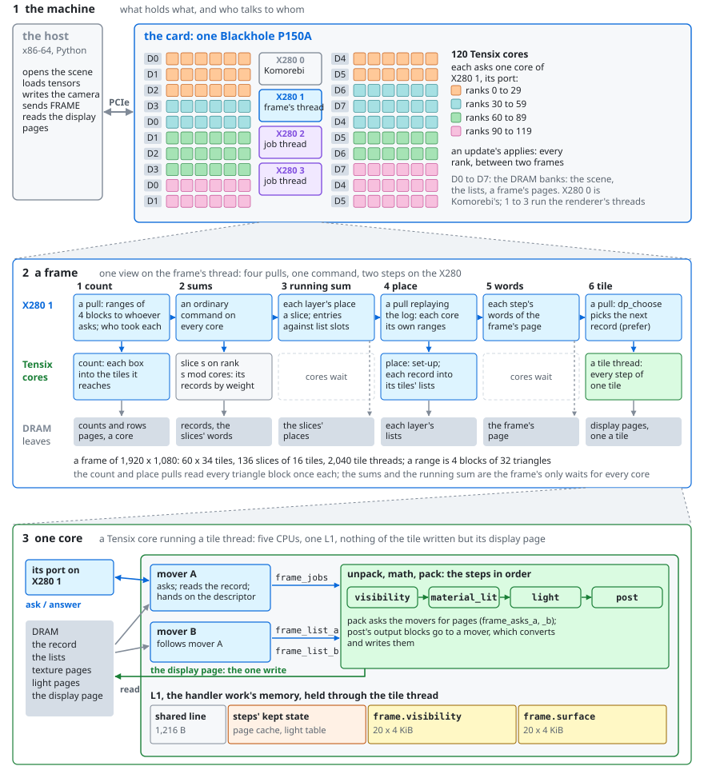

# The handler `work`: a core's side of a thread

Every pull of a view is one command of the handler `work` on every core of the view's
group ([the dispatcher](dispatch.md)). On a core it takes threads from its X280 core one
by one, hands each to the three compute CPUs and to the second mover, runs it to its end,
and asks for the next. This page follows a thread through a core: the five CPUs, the
rings between them, what stays in the core's memory, and every wait with its limit.

<picture>
  <source media="(prefers-color-scheme: dark)" srcset="../../images/levels-dark.svg">
  
</picture>

*The handler `work` is the third level: one core taking a tile thread from its port and running its steps with the planes in its L1.*

The code: `src/prism/program/frame/` (`device.py` the class, `generate.py` the program
composed for a tile thread and its kinds, `host.py` a record and the frame's page on the
host) and its kernels `frame/kernels/` (`frame.h` the layouts, `context.hpp` what a
thread is given, `movement.hpp` the movers, `serve.hpp` a mover's service, `compute.hpp`
and `pack.hpp` the compute CPUs, `account.hpp` the account).

## One class, one program

`device.frame_class` makes the class `FrameWork` for one composition of a tile thread and
the kinds beside it (`generate.compose`, [steps, kinds and the tile thread](steps.md)).
Its handler `work` is a hand kernel whose movement and compute sources are the same
generated file, `work.hpp` (entry `prism_frame::work`): the constants of the composition
(the lists' geometry, the memory's places, the codes held, the output pairs, each kept
state's place, each step's passes, the planes), the loop's kernels, every step's and
kind's header, and the parts they give (`tile_compute`, `kind_compute`, `kind_movers`,
`stream_layers`, `steps_begin`, `serve_outputs`). The class is merged with the sums' class
and the other implementations' classes into one program (`threads/program.py`).

A core's CPUs and what each does in `work`:

| CPU | in every pull | in a tile thread |
|---|---|---|
| mover A | asks its X280 core for threads, reads a tile's record, hands each thread on as a descriptor, tells the ended ones | its share of the list stream; serves its half of the asks and outputs |
| mover B | follows mover A's descriptors | the other share of the list stream; serves its half |
| unpack | takes the frame's page and each descriptor, hands their addresses to math and pack | the steps' unpack parts (hands list blocks on, serves pack's mails) |
| math | copies what unpack hands it | the steps' math parts |
| pack | copies what unpack hands it | the steps' pack parts: asks pages, pushes output blocks, tells the thread's end |

## A thread's life

1. **The command.** Both movers read the command's block, the frame's page. Mover A, in a
   tile pull, runs the steps' `begin` (each step that has one, the view's steps: once a
   command, before the first thread), then copies the page into
   the ring `frame_page` for the compute CPUs. Unpack takes it and mails its address and
   the handler's memory to math and pack. Mover B makes its shared line its own (the
   command's sequence, its threads ended).
2. **The ask.** Mover A waits until at most one thread is taken ahead of the oldest not
   ended on both movers, tells its X280 core the newest thread ended on both (its number,
   its cost in wall clock cycles `>> TA_COST_SHIFT`, the codes the program holds), and asks
   (`km::X280Port::next`). Komorebi's port asks for the next range as soon as it hands one,
   so an answer is usually waiting in the core's control lines when mover A asks.
3. **The descriptor.** An answer of 0 is "none left": the pull is over for this core. Else
   mover A builds a descriptor (32 words, `FD_*`): the pull's kind, the number, the count,
   the tile pull's word, the thread's place among the command's. For a tile it reads the
   record and its slice's words (two 64-byte reads) and copies the record in with each
   layer's slot made absolute; for a range it finds the range's layer, first block and
   blocks from the page. It pushes the descriptor into `frame_jobs` (the compute CPUs) and
   `frame_jobs_b` (mover B), two pages each: the running thread and one ahead.
4. **The run.** Each mover runs its share. In a tile thread that is the list stream: for
   each layer of the view's stream with entries, the layer's list pages from the record's
   slot, in chunks of two blocks dealt to the movers by the pattern AB into the halves
   `frame_list_a` and `frame_list_b` (a Komorebi stream). In a range it is the kind's
   `<kind>_movers`. On the compute side unpack takes the descriptor, mails its address to
   math and pack, each copies it, and unpack frees it; a tile's steps then run in order,
   each `<step>_compute(ctx, tile, planes)` on all three CPUs (for a step with variants,
   the one the word's code names); a range runs `<kind>_compute`.
5. **The end.** A range ends on a mover when its share returns. A tile thread ends on a
   mover when pack's end ask has come (`thread_end`: one into each mover's request ring,
   with the output blocks it pushed into that mover's half) and those blocks are written.
   Mover B writes the time it ended in its shared line; mover A takes a thread as ended
   when both movers have ended it, and tells it with its next ask.
6. **The pull's end.** After "none left" mover A pushes an end descriptor to both rings.
   Each mover waits for the threads it took to end, mover A for mover B's too and tells
   the last one; each CPU runs the kind's `<kind>_end` (a count or place pull writes the
   layer it holds); unpack frees the frame's page once math and pack are done with it.

The record a thread ends with in the account (when built) has the times of each of these
points: [the account of the threads' frame](../../performance/account.md).

## Serving: every wait of a mover

A mover never waits idle: each of its waits (`wait_serving`) serves its half while it
waits, so no wait of one ring can hold a request of another.

- **Asks** (`serve_ask`): a page of the mover's request ring (`frame_asks_a`, `_b`,
  512 bytes, two pages) names a tensor, its page bytes and up to `FA_ENTRIES` (62) pages,
  each with the L1 address it goes to. The mover reads them, waits for the reads, frees
  the ask and pushes a page into its done ring (`frame_dones_a`, `_b`). Pack posts its
  asks to the two movers in turn. The material step asks texture pages this way, the light
  step its light pages.
- **Outputs** (`drain_output`): a block of a step's output half (`frame_out_<name>_a`,
  `_b`, a 16-byte header then the payload) is converted in place by the output's
  function on the mover that took it (the post step's `post_convert`: SHOW's rule) and
  written to the page and byte its header names of the frame page's target. Pack pushes
  an output's blocks into the halves in turn.
- **Ended threads** (`advance`): the tile threads whose end ask came and whose blocks are
  written are marked ended.

## What stays in a core's memory

The handler's memory is a part of the command space (`frame_memory`, the size the
composition registers with `prism.core.fields`):

| bytes | what |
|---|---|
| 0 to 1,215 (`FM_SHARED_BYTES`) | the movers' shared line: mover B's command, threads ended and their end times (a ring of 4 by the thread's place); mover A's scratch for a record and its slice's words; from byte 256 each compute CPU's part (320 bytes: its context, the descriptor it took, the tile) |
| 1,024 more, with the account | the account's counters of the command |
| then | the tile thread's part: each step's kept state, then the planes |
| over the same bytes | each kind's kept state (a count or place pull holds no tile thread) |

- **The planes** are a tile's working planes, kept between the steps of one tile thread:
  `frame.visibility` (5 planes of 32-bit words a layer: depth, red, green, blue as fp32, the
  triangle's word `kTriBase + n`; 4
  layers, 20 pages of 4,096 bytes) in every tile thread, and `frame.surface` (two surfaces
  of 10 pages: the opaque layer's, the glass layer's) in the lit ones. A step reads the
  planes the steps before it left (`TileThread.check` refuses a step that reads a plane no
  step before it leaves). Nothing of a tile's planes leaves the core but the output
  blocks.
- **Kept state** (`keeps`) is a step's or a kind's own bytes, kept on the core across the
  threads of a command: the material step's work, its page cache of 129 pages and the
  pack CPU's state of a tile; the light step's table (read once a command at its begin),
  its work, page table and pass state; the post step's thresholds and buckets (made once
  a command) and its scratch. The count kind keeps the core's counts and row histograms of
  the layer it holds, the place kind its positions and the slices' places, each written
  or dropped when the core leaves the layer.
- **Rings** are the handler's own (`generate.rings_of`):

| ring | pages | pushed by | what |
|---|---|---|---|
| `frame_page` | 2 | mover A | the frame's page for the compute CPUs |
| `frame_jobs`, `frame_jobs_b` | 2 | mover A | descriptors for the compute CPUs and for mover B |
| `frame_list_a`, `frame_list_b` | 2 blocks of list pages | mover A, mover B | the list stream's halves |
| `frame_asks_a`, `_b` | 2 | pack | asks of each mover |
| `frame_dones_a`, `_b` | 2 | mover A, mover B | an ask served |
| `frame_out_<output>_a`, `_b` | the output's blocks | pack | a step's output halves |
| a step's or kind's rings | its own | its own | the kinds' triangle and shade block pairs, their pass's spaces |

A ring Komorebi's movers move as a stream must have its halves among a core's first 32
buffers; `device.streams_checked` refuses the made program otherwise, with the indices.

Every core takes threads of every kind from the same program: no core is reserved for a
step, and which core runs which tile is the X280's answer at that moment.

## Waits and give-ups

Each wait has a place (`frame.h` `FW_*`), recorded in the core's gave-up word when it
gives up, and the command ends there.

| place | CPU | waiting for |
|---|---|---|
| `FW_PAGE` | mover A | room for the frame's page |
| `FW_DESCRIPTOR_ROOM` | mover A | room in a descriptor ring |
| `FW_DESCRIPTOR` | mover B | its next descriptor |
| `FW_AHEAD` | mover A | the thread before the one taken ahead |
| `FW_LIST_ROOM` | a mover | room in its list half |
| `FW_REQUEST` | a mover | an ask's reads landed |
| `FW_OUTPUT` | a mover | an output block's writes left |
| `FW_DRAIN` | a mover | the threads it took ended |
| `FW_RECORD` | mover A | a record and its slice's words landed |
| `FW_C_PAGE`, `FW_C_DESCRIPTOR` | unpack | the frame's page, a descriptor |
| `FW_C_MAIL` | a compute CPU | a word of another |
| `FW_C_ASK`, `FW_C_DONE`, `FW_C_OUT` | pack | room in a request ring, an ask served, room in an output half |
| `FW_BAD` | any | a bad block, descriptor, request or pull |

A mover's wait is Komorebi's (`km::Movement::wait`), within the kernels' wait limit:
Komorebi's, or the threads' option `deadline` (seconds a command may take) plus one
second (`threads/assemble.py`). A compute CPU's wait gives up after `FW_WAIT_CYCLES`
(`0x40000000`) cycles. A step's own waits have their own places in its header. A pull's
wait for an answer gives up as the port's does (`pull_gave_up`). With the option
`recover` false a core that gave up is not reset, so its gave-up words can be read where
it stood (`checks/threads_frame` prints them by name).

## The account

Built only with the threads' host option `account` (`PRISM_FRAME_ACCOUNT`, `DP_ACCOUNT`):
counters a command by (view, pull) in the handler's memory, a record a thread written to
the core's page of the account tensor (`TF_ACCOUNT`) when it ends, and each core's answers
and choosing ticks on the X280. Its words (`FX_*`) and what it measured are
[the account of the threads' frame](../../performance/account.md).

## Checks

`checks/frame_build` composes the handler from a tile thread and kinds given by dotted
path and builds its kernels for the five CPUs with Komorebi's mock build; its own threads
`toy:TOY` and `toy:WALK` (a list pass, an ask, an output with its convert, kept state, a
begin, a code variant) build the loop without any stage's step. `checks/threads_frame`
runs the threads' form against the stage-wise form on a card
([checks](../../guides/checks.md)).
