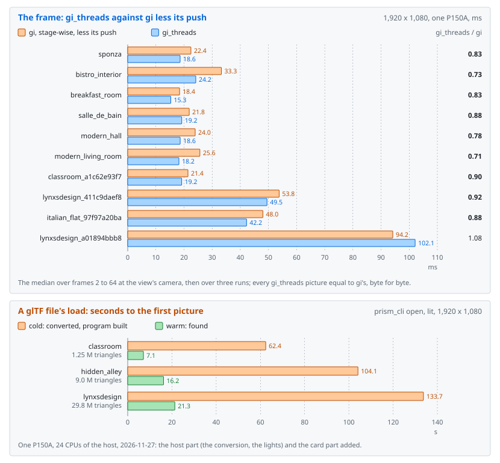

# The renderer's frame: `gi_threads` against `gi`

The renderer, the preset `gi_threads` (the lit frame with the indirect field, run as
threads the cores take, [the frame as threads](../concepts/threads.md)), against its
stage-wise form `gi`, on ten scenes; then the field's update after the sun is moved
once. Every number is from
[measurements/gi_threads](../../measurements/gi_threads/README.md); this page gives what
they say.

Conditions: one Blackhole P150A, 120 cores, AICLK 1,350 MHz, its link at 16 GT/s,
2026-11-28 (UTC+8), Komorebi 0.6.0, 1,920 x 1,080 at the view's camera, every core, each
preset with its own options. 64 frames a load, no sun moved; a run's number is the median
over frames 2 to 64, the number given the median of three interleaved runs. Every frame's
code 0 and every `gi_threads` picture equal to `gi`'s, byte for byte, in all 3,840
frames. ms.

<picture>
  <source media="(prefers-color-scheme: dark)" srcset="../images/results-dark.svg">
  
</picture>

*The frame (above) from [measurements/gi_threads](../../measurements/gi_threads/README.md); the load (below) from [measurements/open](../../measurements/open/README.md).*

## The frame

`gi` pushes its picture into the host's memory inside its frame (its option `push`
true, 0.564 ms); `gi_threads` does not (the post step writes the display's pages from
the cores). "`gi` less push" is the like frame; each ratio is `gi_threads` over it.

`gi_threads` keeps a frame's lists while the view does not change (its option
`keep_lists`, on by default): a standing camera's frame runs the tile pull alone. When
the camera moves, the lists are made again each frame: the count, sums and place pulls
run before the tile pull. Both are given: "stands" is what a viewer shows most of the
time, "moves" the cost of a frame while the camera moves.

| scene (view) | `gi` | `gi` less push | `gi_threads` moves | `gi_threads` stands | ratio moves | ratio stands |
|---|---:|---:|---:|---:|---:|---:|
| sponza (overview) | 24.689 | 24.125 | 20.003 | 16.795 | 0.83 | 0.70 |
| bistro_interior (overview) | 36.226 | 35.663 | 25.247 | 21.154 | 0.71 | 0.59 |
| breakfast_room (overview) | 19.985 | 19.421 | 16.341 | 14.056 | 0.84 | 0.72 |
| salle_de_bain (overview) | 23.908 | 23.344 | 19.696 | 16.010 | 0.84 | 0.69 |
| modern_hall (overview) | 25.457 | 24.893 | 19.384 | 18.370 | 0.78 | 0.74 |
| modern_living_room (overview) | 27.520 | 26.956 | 20.089 | 15.149 | 0.75 | 0.56 |
| classroom_3f4180c5d0 (camera) | 34.581 | 34.017 | 26.514 | 22.037 | 0.78 | 0.65 |
| lynxsdesign_b49574c042 (camera) | 58.580 | 58.016 | 43.664 | 29.433 | 0.75 | 0.51 |
| italian_flat_69651f32b4 (camera) | 52.888 | 52.324 | 40.904 | 29.680 | 0.78 | 0.57 |
| lynxsdesign_6efc48febc (camera) | 101.142 | 100.578 | 67.163 | 37.753 | 0.67 | 0.38 |

The three runs' medians lie within 0.16 ms of each other on every row; the ranges are in
the measurement's table.

## By phase

`gi`'s commands grouped (raster: every pass of both layers, fill included); `gi_threads`'
dispatcher phases with its lists made again (place: the set-up pass and the list writes;
tile: every step of a tile thread), and its tile pull standing. The two do not stand one
for one: the threads' place holds the stage-wise set-up, its tile the stage-wise fill,
shade, light and show.

| scene | `gi` raster | shade | light | show | `gi_threads` count | sums | running | place | tile | standing tile |
|---|---:|---:|---:|---:|---:|---:|---:|---:|---:|---:|
| sponza | 9.902 | 7.436 | 7.285 | 1.535 | 1.079 | 0.324 | 0.052 | 1.879 | 16.720 | 16.735 |
| bistro_interior | 17.023 | 9.409 | 10.739 | 1.541 | 1.298 | 0.459 | 0.063 | 2.394 | 21.081 | 21.084 |
| breakfast_room | 6.862 | 4.473 | 7.572 | 1.614 | 0.787 | 0.187 | 0.042 | 1.339 | 14.012 | 14.008 |
| salle_de_bain | 9.114 | 5.872 | 7.911 | 1.555 | 1.260 | 0.189 | 0.043 | 2.289 | 15.951 | 15.961 |
| modern_hall | 5.452 | 4.620 | 14.927 | 1.583 | 0.391 | 0.324 | 0.053 | 0.414 | 18.267 | 18.311 |
| modern_living_room | 11.556 | 5.429 | 10.588 | 1.620 | 1.555 | 0.324 | 0.054 | 3.110 | 15.092 | 15.091 |
| classroom_3f4180c5d0 | 15.717 | 8.304 | 11.304 | 1.546 | 1.486 | 0.458 | 0.062 | 2.488 | 22.072 | 21.967 |
| lynxsdesign_b49574c042 | 32.742 | 12.527 | 13.202 | 1.528 | 4.610 | 0.324 | 0.052 | 9.324 | 29.371 | 29.375 |
| italian_flat_69651f32b4 | 26.237 | 12.691 | 13.722 | 1.555 | 3.778 | 0.325 | 0.053 | 7.157 | 29.611 | 29.621 |
| lynxsdesign_6efc48febc | 72.845 | 14.544 | 13.536 | 1.577 | 9.565 | 0.323 | 0.052 | 19.545 | 37.722 | 37.694 |

The steps' words take 0.002 ms in every row; standing, count and place take under
0.005 ms.

## The field's update after one sun move

One run a preset a scene: 8 frames, the sun set to (120, 40) through the loop's control,
32 frames. The update's passes are the scene's own count ("bounces"). `gi` sends the
sun's pass and the update before the next frame and waits: "stop" is the host's ms from
the control set to the end of the first frame at the new sun, "update" the update's card
time. `gi_threads` runs the update as the job thread's graph beside the frames, each
apply a step of every core between two frames: "frames during" are drawn with the old
field, "to swap" is the host's ms from the control set to the end of the first frame
with the new field. Every code 0.

| scene | bounces | `gi` stop | `gi` update | `gi_threads` frames during | their ms | steady ms | first frame at the new sun | to swap |
|---|---:|---:|---:|---:|---|---:|---:|---:|
| sponza | 3 | 173.4 | 108.1 | 5 | 16.7 to 20.0 | 16.74 | 60.9 | 161.4 |
| bistro_interior | 2 | 203.5 | 106.8 | 4 | 21.0 to 25.2 | 21.14 | 67.0 | 167.5 |
| breakfast_room | 12 | 188.6 | 134.3 | 14 | 14.0 to 16.3 | 13.98 | 55.4 | 288.8 |
| salle_de_bain | 10 | 270.6 | 200.3 | 12 | 16.1 to 19.7 | 16.07 | 61.0 | 298.7 |
| modern_hall | 10 | 240.5 | 188.5 | 13 | 17.5 to 19.7 | 18.13 | 43.9 | 330.5 |
| modern_living_room | 15 | 350.9 | 287.0 | 19 | 15.2 to 20.1 | 15.24 | 64.7 | 425.1 |
| classroom_3f4180c5d0 | 3 | 192.4 | 104.0 | 5 | 21.9 to 26.5 | 22.03 | 74.1 | 202.9 |
| lynxsdesign_b49574c042 | 5 | 293.7 | 153.5 | 7 | 29.3 to 43.7 | 29.43 | 92.5 | 320.6 |
| italian_flat_69651f32b4 | 8 | 277.8 | 136.5 | 9 | 29.5 to 41.0 | 29.64 | 112.3 | 409.1 |
| lynxsdesign_6efc48febc | 8 | (did not end) |  | 10 | 37.6 to 67.2 | 37.78 | 147.8 | 567.5 |

## What the numbers say

- **The renderer's frame is the faster one on every scene**: 0.67 to 0.84 of `gi` less
  its push while the camera moves, 0.38 to 0.74 while it stands. A tile's steps (fill,
  shade, light, show) run on the core that took it, its planes kept in L1, as one tile
  pull; a standing camera runs that pull alone.
- **The larger the scene, the more a standing camera saves**: on the largest scene
  (lynxsdesign_6efc48febc, 29.8 million triangles) the count and place pulls take 29.1
  ms of the moving frame's 67.2, and the standing frame is 37.8 ms.
- **The update does not stop the frames.** `gi` waits 173.4 to 350.9 ms for the sun's
  pass and the update; `gi_threads` draws 4 to 19 frames during it, the first at the
  moving frame's time, the others at the steady frame's. On lynxsdesign_6efc48febc the
  stage-wise `gi` with a sun move did not end within its run's 900 s.

## What is not measured

- A moving path (reloads, recoveries): the moving frame here is the lists made again
  each frame at one camera.
- The account (no core's time, bytes or records); the other ways of handing out
  (`order`, `kept`) and a tile cut (`heavy`) for `gi_threads`.
- The update's columns are one run a scene and hold host time.
