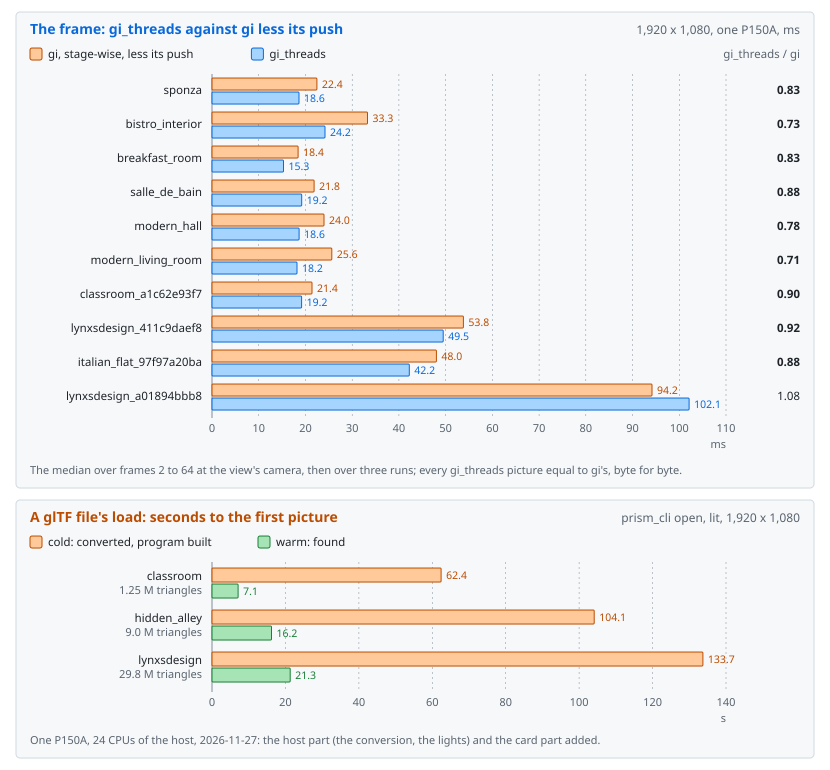

# Opening a scene: where the seconds of a load go

`python -m prism_cli open <file>` ([the command line](../guides/cli.md)) converts a glTF
file once, makes its lights, loads a preset and draws its frames. Every number is from
[measurements/open](../../measurements/open/README.md), which gives each part of each
run; this page gives what they say.

Conditions: one Blackhole P150A (card 1, a shared card; the wait for its lock is outside
every time), 1,920 x 1,080, 16 frames on the scene's view, four scenes of the artists'
table exported by the Blender workbench ([artists' scenes](../guides/artist_scenes.md)).
Seconds.

<picture>
  <source media="(prefers-color-scheme: dark)" srcset="../images/results-dark.svg">
  
</picture>

*The frame (above) from [measurements/gi_threads](../../measurements/gi_threads/README.md); the load (below) from [measurements/open](../../measurements/open/README.md), the waste cut, 2026-11-27.*

## The first picture, 2026-11-26

Komorebi at e908d6d16, 8 host CPUs. Cold: the data root empty of the scene and the build
caches (Komorebi's, tt-metal's) empty; warm: the same command again. `lit` with the
lights' sky visibility 1 (`open`), or after the bake (`baked`).

| scene | triangles drawn | textured, cold | textured, warm | lit, lights open | lit, lights baked |
|---|---:|---:|---:|---:|---:|
| classroom | 607,484 | 44.1 | 4.5 | 54.3 | 7.6 |
| italian_flat | 3,358,422 | 72.0 | 12.1 | 107.8 | 23.9 |
| lynxsdesign | 8,806,420 | 114.2 | 24.1 | 165.2 | 45.2 |
| hidden_alley | 8,994,024 | 137.6 | 29.8 | 171.0 | (bake stopped) 38.3 |

A cold load's largest parts are the conversion (2.4 to 61.7 s), Komorebi's host module
built (17 to 21 s), the program built and launched (14 to 17 s) and the hosts' tables;
in `lit` with open lights the host's shadow map (12 to 99 s). A warm load is the hosts'
tables (`model.raster`, `model.material.texture`) and the session's start.

## The hosts' tables made once

Each layer's mesh and shade blocks made once for both hosts and kept under
`$PRISM_CACHE/blocks/`, the lists sized from the pieces' boxes alone
([the raster model](../internals/raster/model.md#the-lists-slots-a-load-holds)): the
first picture before, at the first open that makes the blocks, and at a later open that
finds them.

| scene | preset | before | first | kept |
|---|---|---:|---:|---:|
| classroom | textured | 4.5 | 4.0 | 3.6 |
| italian_flat | lit | 23.9 | 15.5 | 12.3 |
| lynxsdesign | textured | 24.1 | 17.1 | 10.5 |
| lynxsdesign | lit | 45.2 | 29.4 | 21.3 |
| hidden_alley | lit | 38.3 | 26.9 | 18.9 |

## The first lit picture without the host's shadow map

`open` makes the lights with the sun's map left to the card (the preset's `sun` command
draws it before the first lit frame) and keeps the lists' counts under
`$PRISM_CACHE/counts/`. First lit open, before and after: classroom 54.3 and 57.1,
italian_flat 107.8 and 43.0, lynxsdesign 165.2 and 53.1, hidden_alley 171.1 and 56.8;
the second open 4.2, 8.7, 11.4 and 13.8.

## The waste cut, 2026-11-27

The load `gi` needs on three new exports (classroom 1,252,126 triangles, lynxsdesign
29,756,735, hidden_alley 8,994,697), before and after the work nobody needed was taken
out: Komorebi 0.6.0, 24 host CPUs, the host part (conversion and lights, no card) and
`python -m prism_cli open <folder>/scene.glb --pipeline lit --bake none --size 1920 1080
--card 1`. A scene opened from glTF has no transport set, so `gi` opens on it without
the far field, with the implementations of `lit` ([presets](../guides/cli.md#the-presets)):
its load is `lit`'s. Every converted file and every picture is equal byte for byte before
and after.

| part, lynxsdesign / hidden_alley / classroom | before | after |
|---|---|---|
| the conversion, all steps and the digest | 174.8 / 75.2 / 14.1 | 33.7 / 21.9 / 4.2 |
| `model.raster`, cold | 112.4 / 18.6 / 3.3 | 21.5 / 8.2 / 1.6 |
| `model.raster`, warm | 7.7 / 3.2 / 0.45 | 0.70 / 0.67 / 0.30 |

| scene | first picture, cold before | cold after | warm before | warm after |
|---|---:|---:|---:|---:|
| lynxsdesign | 372.0 | 133.7 | 31.2 | 21.3 |
| hidden_alley | 170.9 | 104.1 | 19.8 | 16.2 |
| classroom | 81.6 | 62.4 | 7.6 | 7.1 |

What a cold load still spends on lynxsdesign: Komorebi's host module built (17.1, one
compiler on one CPU), the program built (8.2) and launched (9.2, with the card opened
again and every tensor written again when the kernels ask for a larger kernel buffer),
the tensors (22.1 GB in 16.4 s; an upper bound, the link's speed during the runs was not
recorded and it was found slow later that day), the files' digest (2.7, every open), the conversion's
writing (5.5).

## The sky's visibility bake

`open --bake background` starts it as a process of its own; 64 rays a vertex, 24
processes. The compiled batch tracer replaced the numpy tracer with the same walk and
triangle test, the baked visibility equal byte for byte:

| scene | vertices | before, rays a second | after: tree and files, s | after: bake, s | after, rays a second |
|---|---:|---:|---:|---:|---:|
| classroom | 963,928 | 598,898 | 11.1 | 7.3 | 8,429,000 |
| hidden_alley | 9,115,111 | 248,097 | 36.0 | 78.0 | 7,478,000 |
| lynxsdesign | 19,745,143 | 313,904 | 84.9 | 125.4 | 10,078,000 |
